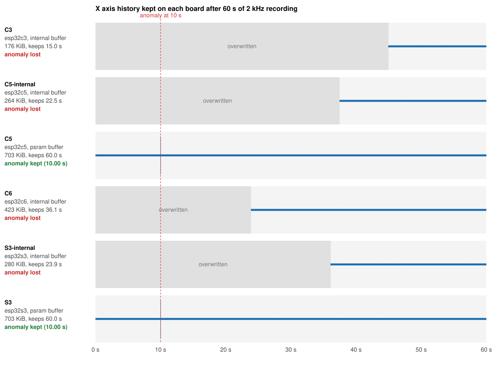

# PSRAM history recorder, 60 s at 2 kHz

- Simulated 3-axis data, 6 bytes per sample; anomaly injected at 10 s.
- Full history needs 720,000 bytes.
- Boards are recorded one at a time with the same firmware source and ESP-IDF version.

| Board | Chip | CPU MHz | Buffer memory | Buffer bytes | History kept | Range kept | Anomaly | Internal free after | Dump time | Recorded | Note |
|---|---|---:|---|---:|---:|---|---|---:|---:|---|---|
| C3 | esp32c3 v0.4 | 160 | internal | 180,156 | 15.0 s | 45.0–60.0 s | lost | 142,936 | 2.31 s | 2026-11-20T10:49:29 | USB powered, desk |
| C5-internal | esp32c5 v1.0 | 240 | internal | 270,270 | 22.5 s | 37.5–60.0 s | lost | 55,059 | 1.91 s | 2026-11-20T10:50:44 | USB powered, desk; PSRAM unused |
| C5 | esp32c5 v1.0 | 240 | psram | 720,000 | 60.0 s | 0.0–60.0 s | kept | 325,339 | 4.92 s | 2026-11-20T10:49:32 | USB powered, desk |
| C6 | esp32c6 v0.1 | 160 | internal | 433,320 | 36.1 s | 23.9–60.0 s | lost | 32,768 | 7.01 s | 2026-11-20T10:49:33 | USB powered, desk |
| S3-internal | esp32s3 v0.2 | 240 | internal | 286,656 | 23.9 s | 36.1–60.0 s | lost | 92,499 | 5.31 s | 2026-11-20T10:50:47 | USB powered, desk; PSRAM unused |
| S3 | esp32s3 v0.2 | 240 | psram | 720,000 | 60.0 s | 0.0–60.0 s | kept | 379,227 | 13.13 s | 2026-11-20T10:49:40 | USB powered, desk |

