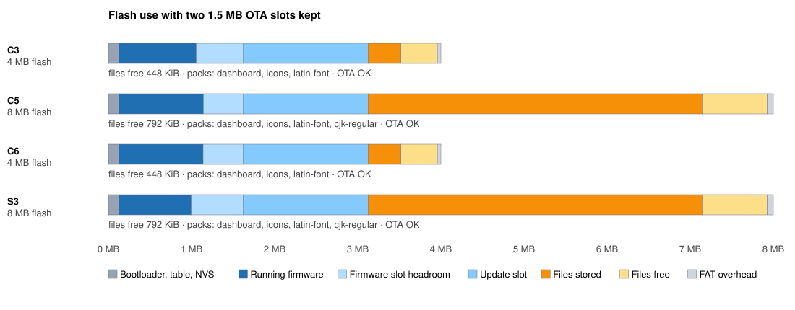

# Flash + OTA: what still fits after keeping two update slots

- Same firmware source, ESP-IDF version and partition rule on every board: two 1.5 MB OTA slots, the rest of the flash as a FAT file area.
- Resource packs are installed in order; a pack that does not fit is removed and the later packs are skipped.
- After installing, the V2 firmware is sent by HTTP OTA; every stored file is then read back and hash-checked.

| Board | Chip | Flash | Running firmware | OTA slot | File area | Files stored | Files free | dashboard | icons | latin-font | cjk-regular | cjk-bold | OTA V1→V2 | Files intact after OTA | Recorded | Note |
|---|---|---:|---:|---:|---:|---:|---:|---|---|---|---|---|---|---|---|---|
| C3 | esp32c3 | 4 MB | 954 KiB | 1,536 KiB ×2 | 852 KiB | 404 KiB | 448 KiB | yes | yes | yes | does not fit | - | OK (18.6 s) | 15/15, dashboard HTTP 200 | 2026-11-20T11:23:45 | USB powered, desk |
| C5 | esp32c5 | 8 MB | 1,042 KiB | 1,536 KiB ×2 | 4,916 KiB | 4,124 KiB | 792 KiB | yes | yes | yes | yes | does not fit | OK (23.3 s) | 119/119, dashboard HTTP 200 | 2026-11-20T11:22:31 | USB powered, desk |
| C6 | esp32c6 | 4 MB | 1,039 KiB | 1,536 KiB ×2 | 852 KiB | 404 KiB | 448 KiB | yes | yes | yes | does not fit | - | OK (19.9 s) | 15/15, dashboard HTTP 200 | 2026-11-20T11:24:43 | USB powered, desk |
| S3 | esp32s3 | 8 MB | 893 KiB | 1,536 KiB ×2 | 4,916 KiB | 4,124 KiB | 792 KiB | yes | yes | yes | yes | does not fit | OK (15.5 s) | 119/119, dashboard HTTP 200 | 2026-11-20T11:27:01 | USB powered, desk |

Resource packs:

- `dashboard`: Web dashboard + Chart.js (71 KiB) stored size
- `icons`: Font Awesome Free icons (202 KiB) stored size
- `latin-font`: Inter UI font, regular + bold (46 KiB) stored size
- `cjk-regular`: Noto Sans SC Chinese font, regular (3,487 KiB) stored size
- `cjk-bold`: Noto Sans SC Chinese font, bold (3,564 KiB) stored size

