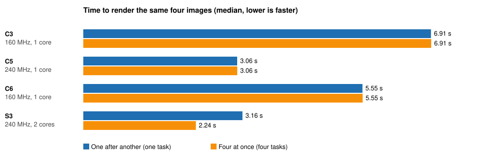
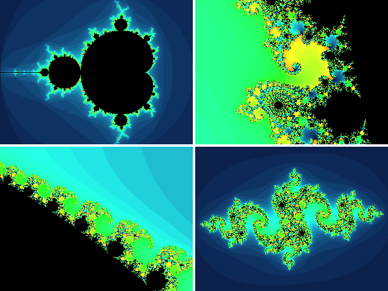

# CPU: time to render the same four images

- Four fractal images (mandelbrot, seahorse-valley, elephant-valley, julia), 320×240 each, up to 255 iterations per pixel, 26,230,366 iterations in total.
- Integer-only fixed-point math (Q7.24), so every chip computes exactly the same pixels; same source, ESP-IDF version and -O2 optimisation; Wi-Fi off.
- `seq`: one task renders the four images one after another. `par`: four tasks render one image each at the same time; on the dual-core S3 they spread over both cores.
- Only computation is timed on the board with esp_timer; images are sent to the computer afterwards.

| Board | Chip | Cores | CPU MHz | seq median | seq min–max | par median | par min–max | Speed vs C3 (seq) | Runs | Same pixels as C3 | Recorded | Note |
|---|---|---:|---:|---:|---:|---:|---:|---:|---:|---|---|---|
| C3 | esp32c3 | 1 | 160 | 6.906 s | 6.906–6.906 s | 6.911 s | 6.911–6.911 s | 1.00× | 5+5 | yes | 2026-11-20T11:37:42 | USB powered, desk |
| C5 | esp32c5 | 1 | 240 | 3.057 s | 3.057–3.057 s | 3.058 s | 3.058–3.058 s | 2.26× | 5+5 | yes | 2026-11-20T11:38:19 | USB powered, desk |
| C6 | esp32c6 | 1 | 160 | 5.545 s | 5.545–5.545 s | 5.549 s | 5.549–5.549 s | 1.25× | 5+5 | yes | 2026-11-20T11:39:25 | USB powered, desk |
| S3 | esp32s3 | 2 | 240 | 3.162 s | 3.162–3.162 s | 2.236 s | 2.236–2.236 s | 2.18× | 5+5 | yes | 2026-11-20T11:40:01 | USB powered, desk |

