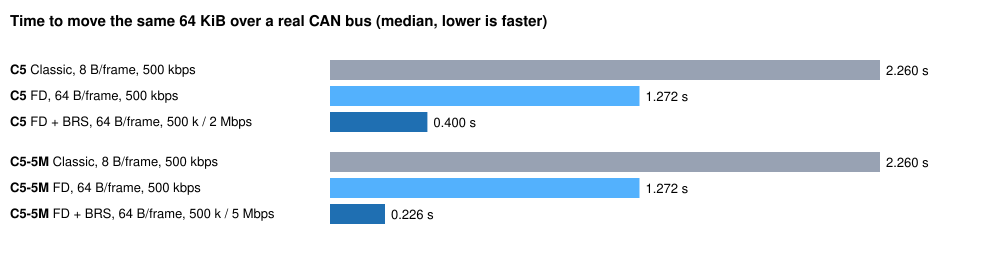

# CAN FD: classic CAN and CAN FD moving the same data block

- One XIAO ESP32-C5 drives two CAN transceivers on one twisted-pair bus with its two TWAI controllers; node A sends a 65,536-byte block to node B, which acknowledges every frame.
- Each frame carries its sequence number in a 29-bit extended ID, so the whole payload is data. Node B puts every frame in place by sequence number; the block is then compared by CRC32.
- Time runs on the board from the first transmit to the last receive. Both bus terminations are 120 Ω.

| Board | Mode | Arbitration | Data phase | Bytes/frame | Frames | Median time | Min–max | Payload rate | vs classic | Data intact | Missing | Bus errors | Runs | Recorded | Note |
|---|---|---:|---:|---:|---:|---:|---:|---:|---:|---|---:|---:|---:|---|---|
| C5 | Classic CAN, 8-byte frames | 500 kbps | same | 8 | 8,192 | 2.260 s | 2.260–2.260 s | 232 kbps | 1.00× | yes | 0 | 0 | 3 | 2026-11-20T14:15:36 | two Adafruit CAN Pal, short jumper wires, both terminations on |
| C5 | CAN FD, 64-byte frames, no bit-rate switch | 500 kbps | same | 64 | 1,024 | 1.272 s | 1.272–1.272 s | 412 kbps | 1.78× | yes | 0 | 0 | 3 | 2026-11-20T14:15:36 | two Adafruit CAN Pal, short jumper wires, both terminations on |
| C5 | CAN FD, 64-byte frames, faster data phase | 500 kbps | 2 Mbps | 64 | 1,024 | 0.400 s | 0.400–0.400 s | 1310 kbps | 5.65× | yes | 0 | 0 | 3 | 2026-11-20T14:15:36 | two Adafruit CAN Pal, short jumper wires, both terminations on |
| C5-5M | Classic CAN, 8-byte frames | 500 kbps | same | 8 | 8,192 | 2.260 s | 2.260–2.260 s | 232 kbps | 1.00× | yes | 0 | 0 | 3 | 2026-11-20T14:16:04 | two Adafruit CAN Pal, short jumper wires, both terminations on |
| C5-5M | CAN FD, 64-byte frames, no bit-rate switch | 500 kbps | same | 64 | 1,024 | 1.272 s | 1.272–1.272 s | 412 kbps | 1.78× | yes | 0 | 0 | 3 | 2026-11-20T14:16:04 | two Adafruit CAN Pal, short jumper wires, both terminations on |
| C5-5M | CAN FD, 64-byte frames, faster data phase | 500 kbps | 5 Mbps | 64 | 1,024 | 0.226 s | 0.226–0.226 s | 2320 kbps | 10.00× | yes | 0 | 0 | 3 | 2026-11-20T14:16:04 | two Adafruit CAN Pal, short jumper wires, both terminations on |

Other boards (controller capability, ESP-IDF v6.1.1 `soc_caps.h`):

| Board | Chip | TWAI controllers | Classic CAN | CAN FD |
|---|---|---:|---|---|
| C5 | esp32c5 | 2 | yes | yes |
| C3 | esp32c3 | 1 | yes | not supported |
| C6 | esp32c6 | 2 | yes | not supported |
| S3 | esp32s3 | 1 | yes | not supported |

A 64-byte frame carries 8× the data of an 8-byte frame, but the ID, control field, CRC and gaps are paid per frame, so the gain in time is the ratio in the *vs classic* column.

