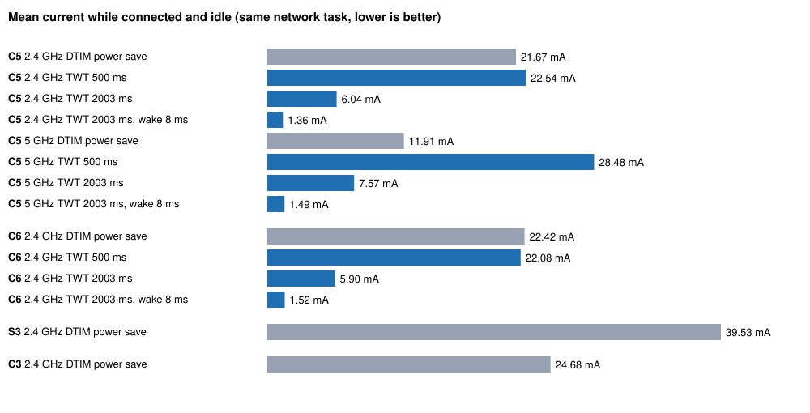
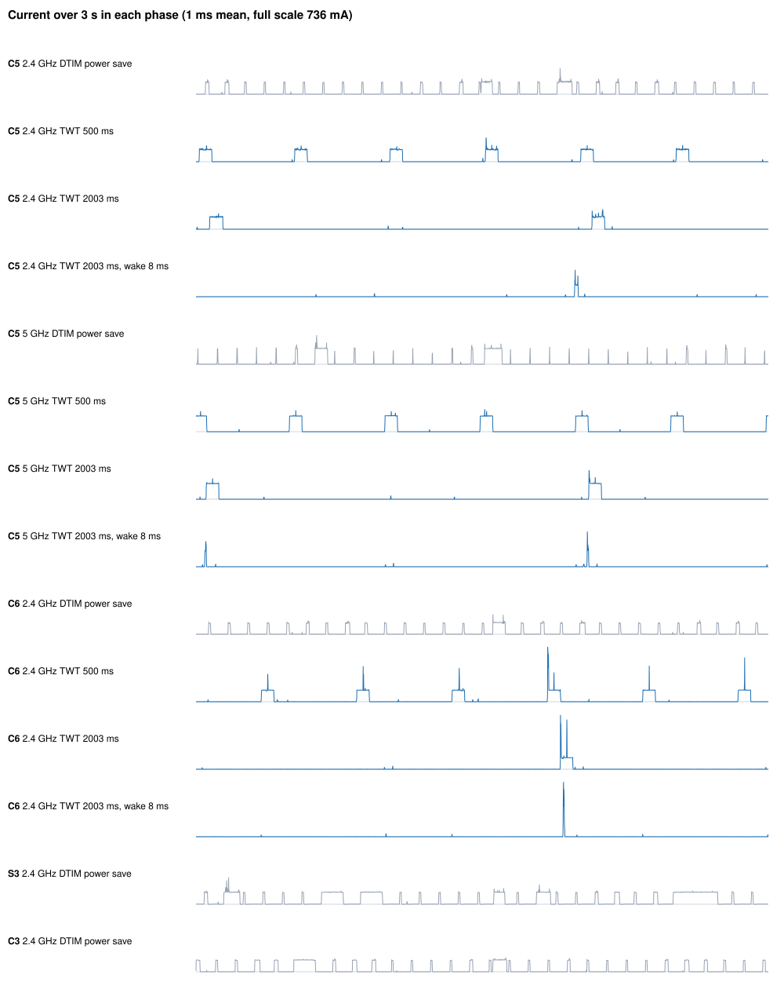

# Wi-Fi power: DTIM power save and Wi-Fi 6 Target Wake Time

- Every phase runs the same task: stay connected, answer a PING from the computer every 3-7 s (random) and send a 64-byte UDP report every 10 s. Only the power-save method changes.
- *DTIM power save* is 802.11 modem sleep, waking for every DTIM beacon. *TWT* is an individual Target Wake Time agreement (Wi-Fi 6) negotiated with the router; the board then wakes only at the agreed interval.
- The PPK2 powers the board at the battery pads with USB unplugged. Mean current covers each phase minus 1 s after the start marker and 0.5 s before the end marker. Light sleep and CPU frequency scaling are on in every phase.
- *Light-sleep floor* is the 5th percentile of the 1 ms current in the phase's 3-second trace: the current between Wi-Fi wake-ups while the connection is kept.
- Ping time is the round trip seen by the computer; it shows how long a command waits for a sleeping board.

| Board | Phase | TWT agreed (interval / wake) | Channel | RSSI | PHY | Mean current | vs DTIM PS | Light-sleep floor | Ping median | Ping p90 | Pings lost | Reports | Recorded | Note |
|---|---|---|---:|---:|---|---:|---:|---:|---:|---:|---:|---:|---|---|
| C5 | 2.4 GHz DTIM power save | - | 10 | -27 dBm | HE20 | 21.67 mA | - | 0.20 mA | 76 ms | 104 ms | 0/12 | 6 | 2026-11-20T17:00:19 | ASUS router, about 1 m, battery pads 3.7 V |
| C5 | 2.4 GHz TWT 500 ms | 500 ms / 65.3 ms | 10 | -27 dBm | HE20 | 22.54 mA | +4% | 0.21 mA | 163 ms | 316 ms | 1/13 | 6 | 2026-11-20T17:00:19 | ASUS router, about 1 m, battery pads 3.7 V |
| C5 | 2.4 GHz TWT 2003 ms | 2003 ms / 65.3 ms | 10 | -25 dBm | HE20 | 6.04 mA | -72% | 0.20 mA | 529 ms | 1609 ms | 0/11 | 6 | 2026-11-20T17:00:19 | ASUS router, about 1 m, battery pads 3.7 V |
| C5 | 2.4 GHz TWT 2003 ms, wake 8 ms | 2003 ms / 8.2 ms | 10 | -24 dBm | HE20 | 1.36 mA | -94% | 0.17 mA | 3854 ms | 8157 ms | 3/12 | 6 | 2026-11-20T17:00:19 | ASUS router, about 1 m, battery pads 3.7 V |
| C5 | 5 GHz DTIM power save | - | 60 | -28 dBm | HE20 | 11.91 mA | - | 0.17 mA | 68 ms | 85 ms | 0/12 | 6 | 2026-11-20T17:00:19 | ASUS router, about 1 m, battery pads 3.7 V |
| C5 | 5 GHz TWT 500 ms | 500 ms / 65.3 ms | 60 | -30 dBm | HE20 | 28.48 mA | +139% | 0.21 mA | 259 ms | 356 ms | 0/12 | 6 | 2026-11-20T17:00:19 | ASUS router, about 1 m, battery pads 3.7 V |
| C5 | 5 GHz TWT 2003 ms | 2003 ms / 65.3 ms | 60 | -30 dBm | HE20 | 7.57 mA | -36% | 0.19 mA | 541 ms | 1468 ms | 0/12 | 6 | 2026-11-20T17:00:19 | ASUS router, about 1 m, battery pads 3.7 V |
| C5 | 5 GHz TWT 2003 ms, wake 8 ms | 2003 ms / 8.2 ms | 60 | -30 dBm | HE20 | 1.49 mA | -87% | 0.18 mA | 3349 ms | 5548 ms | 0/11 | 6 | 2026-11-20T17:00:19 | ASUS router, about 1 m, battery pads 3.7 V |
| C6 | 2.4 GHz DTIM power save | - | 10 | -55 dBm | HE20 | 22.42 mA | - | 0.00 mA | 77 ms | 113 ms | 0/13 | 6 | 2026-11-20T17:31:30 | ASUS router, about 1 m, battery pads 3.7 V |
| C6 | 2.4 GHz TWT 500 ms | 500 ms / 65.3 ms | 10 | -56 dBm | HE20 | 22.08 mA | -2% | 0.00 mA | 287 ms | 425 ms | 0/13 | 6 | 2026-11-20T17:31:30 | ASUS router, about 1 m, battery pads 3.7 V |
| C6 | 2.4 GHz TWT 2003 ms | 2003 ms / 65.3 ms | 10 | -56 dBm | HE20 | 5.90 mA | -74% | 0.00 mA | 1167 ms | 1756 ms | 0/12 | 6 | 2026-11-20T17:31:30 | ASUS router, about 1 m, battery pads 3.7 V |
| C6 | 2.4 GHz TWT 2003 ms, wake 8 ms | 2003 ms / 8.2 ms | 10 | -55 dBm | HE20 | 1.52 mA | -93% | 0.00 mA | 2485 ms | 6451 ms | 3/12 | 6 | 2026-11-20T17:31:30 | ASUS router, about 1 m, battery pads 3.7 V |
| S3 | 2.4 GHz DTIM power save | - | 10 | -47 dBm | HT20 | 39.53 mA | - | 0.37 mA | 70 ms | 107 ms | 0/13 | 6 | 2026-11-20T18:14:50 | ASUS router, about 1 m, battery pads 4.2 V (Wi-Fi start-up peak about 730 mA) |
| C3 | 2.4 GHz DTIM power save | - | 10 | -19 dBm | HT20 | 24.68 mA | - | 0.18 mA | 81 ms | 120 ms | 0/14 | 6 | 2026-11-20T18:29:57 | ASUS router, about 1 m, battery pads 3.7 V |

