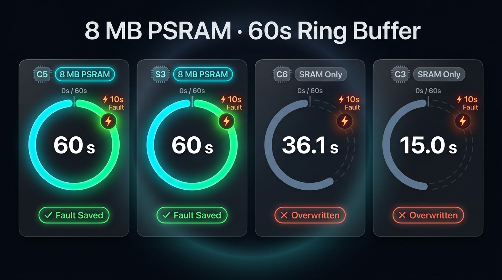
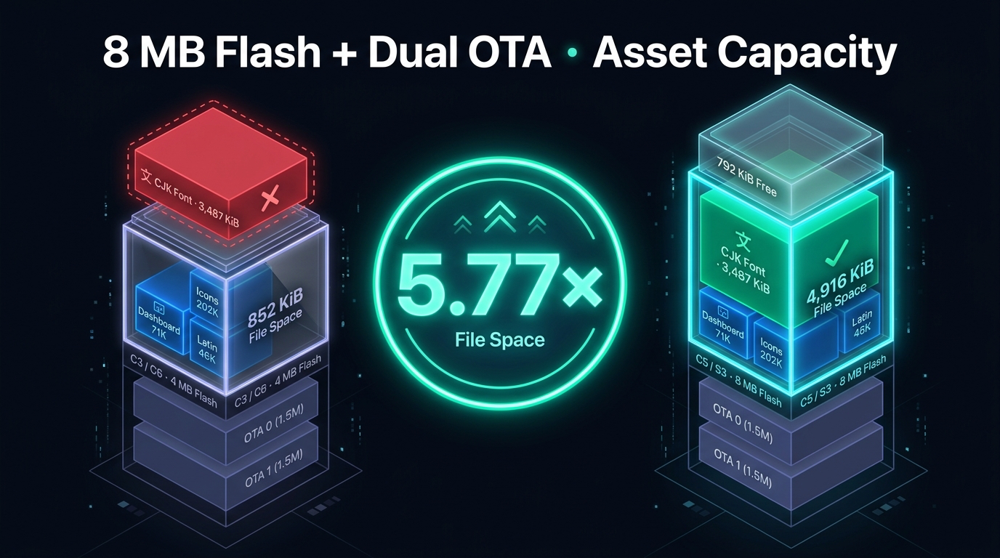
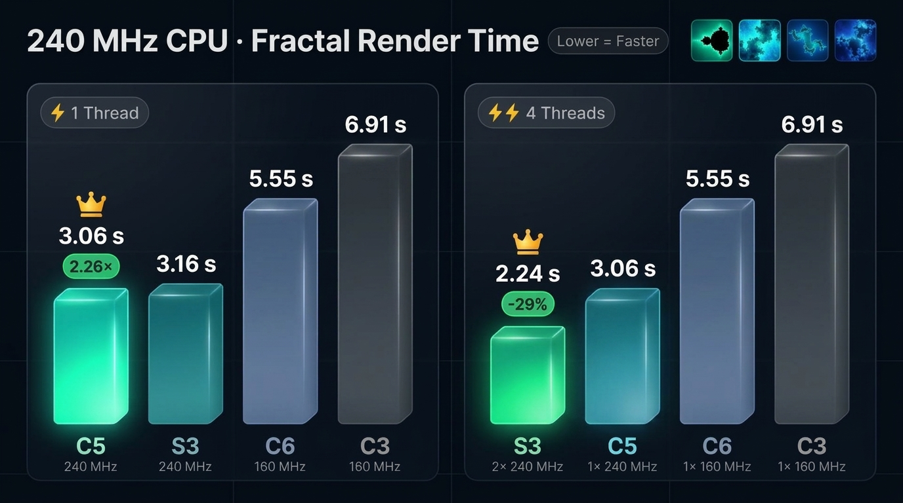
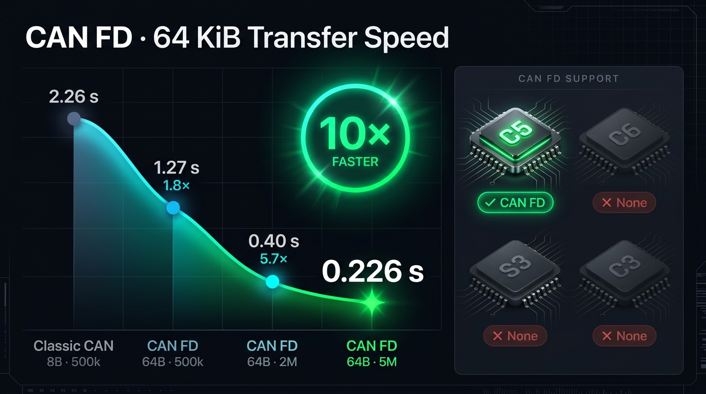
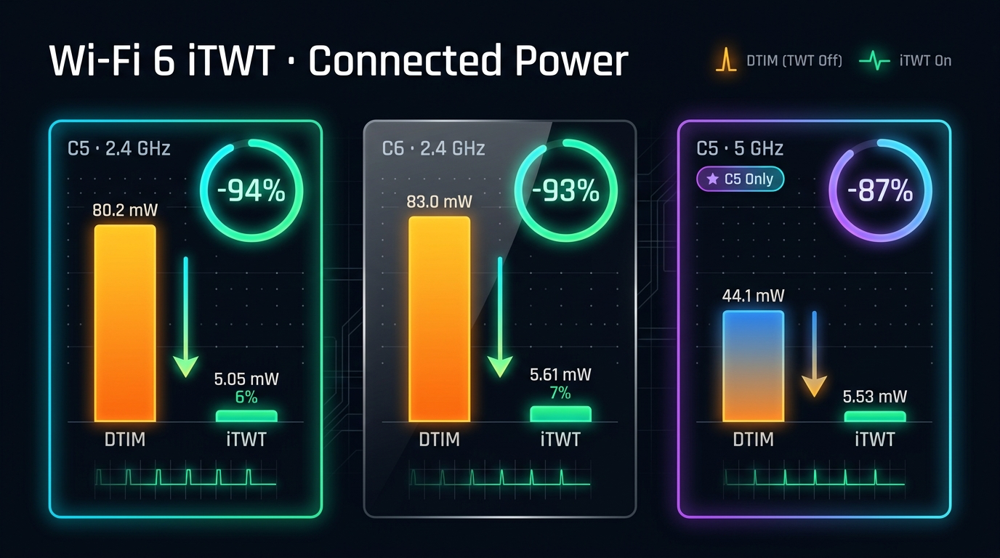

# Four XIAO Boards Tested Side by Side: A $6.90 ESP32-C5 Performance Comparison and Buying Guide

Back when the [Espressif ESP32-C5](https://www.espressif.com/en/products/socs/esp32-c5) was first announced, plenty of my hardware friends wouldn't stop talking about it. The reason was simple enough: after years of tinkering with ESP32s, we were finally getting a tiny microcontroller that could talk to 5 GHz Wi-Fi. Once real boards started landing on desks, though, I went looking for hands-on reviews and came away a bit unsatisfied. Almost everything out there was just reading numbers off the datasheet. Hardly anyone was putting this new chip on the same bench as the C3, C6, and S3 boards already piled up in our parts drawers, flashing the exact same firmware, and running real everyday jobs on them. Our older boards still work fine, after all, so it's tough to tell from paper specs alone what headaches a slightly pricier C5 actually solves.

If you want a fair fight across four generations of chips, standardizing the development board saves a ton of grief. Off-the-shelf dev boards vary wildly in their support circuitry, and voltage regulator quiescent current alone can swing low-power measurements all over the place. So I picked Seeed Studio's XIAO family as the shared test platform and lined up all four siblings: [XIAO ESP32-C3](https://www.seeedstudio.com/Seeed-XIAO-ESP32C3-p-5431.html), [XIAO ESP32-C6](https://www.seeedstudio.com/Seeed-Studio-XIAO-ESP32C6-p-5884.html), [XIAO ESP32-S3](https://www.seeedstudio.com/XIAO-ESP32S3-p-5627.html), and the new [XIAO ESP32-C5](https://www.seeedstudio.com/Seeed-Studio-XIAO-ESP32C5-p-6609.html). All four share the exact same thumb-sized footprint (about 21 × 18 mm), matching pinouts, an external antenna connector, and 3.7 V lithium battery pads on the back, which puts power delivery and form factor on equal footing. I'm also partial to XIAO boards for my own weekend builds: they're tiny enough to tuck inside a smart ring box, a wearable badge, or a robot arm joint, they plug straight into a breadboard with solderless Grove sensors for quick prototyping, and those flat castellated pads on the back let you reflow them right onto a custom PCB once your prototype works.

## Price Comparison and the Five Real-World Tests

Before we flash any code, let's put current single-unit retail prices and core specs side by side:

| Board Model | CPU & Clock Speed | RAM & Flash | Wireless & Notable Buses | Single-Unit Price |
| --- | --- | --- | --- | --- |
| [XIAO ESP32-C3](https://www.seeedstudio.com/Seeed-XIAO-ESP32C3-p-5431.html) | Single-core RISC-V · 160 MHz | 400 KB SRAM · 4 MB Flash | 2.4G Wi-Fi 4 + BLE 5.0 | $4.90 |
| [XIAO ESP32-C6](https://www.seeedstudio.com/Seeed-Studio-XIAO-ESP32C6-p-5884.html) | Single-core RISC-V · 160 MHz (+ LP core) | 512 KB SRAM · 4 MB Flash | 2.4G Wi-Fi 6 + BLE + Zigbee/Thread | $5.20 |
| [**XIAO ESP32-C5**](https://www.seeedstudio.com/Seeed-Studio-XIAO-ESP32C5-p-6609.html) | **Single-core RISC-V · 240 MHz (+ LP core)** | **384 KB SRAM + 8 MB PSRAM · 8 MB Flash** | **2.4G/5G Dual-Band Wi-Fi 6 + BLE + Zigbee/Thread + CAN FD** | **$6.90** |
| [XIAO ESP32-S3](https://www.seeedstudio.com/XIAO-ESP32S3-p-5627.html) | Dual-core Xtensa LX7 · 240 MHz | 512 KB SRAM + 8 MB PSRAM · 8 MB Flash | 2.4G Wi-Fi 4 + BLE 5.0 | $7.49 |

Looking at the price tags, the C5 costs $2.00 more than the entry-level C3, $1.70 more than the Wi-Fi 6 and Zigbee-equipped C6, and about $0.60 less than the S3. For a tiny board in the five-dollar ballpark, paying 30% to 40% more than a C3 or C6 is a noticeable bump.

Plenty of folks will probably squint at this table and wonder the same thing: a small microcontroller usually just sends a few sensor readings or listens for basic toggle commands, barely scratching what 2.4 GHz bandwidth can handle, so is it really worth shelling out two extra bucks just for 5 GHz? Look closer and you can also spot Espressif's careful product segmentation: the C5's internal high-speed SRAM is actually down to 384 KB, smaller than the C6's 512 KB, and it's still a single-core chip compared to the dual-core S3. If $6.90 only buys you bragging rights about connecting to a 5 GHz router, that's a tough sell.

Read further across that row, though, and there's quite a bit more going on under the hood: 8 MB of external PSRAM, flash doubled to 8 MB, a 240 MHz clock bump, two built-in CAN FD controllers none of the others have, and dual-band Wi-Fi 6 sleep features. How much of a difference those upgrades make in real projects, and where the C5 still falls short, is exactly what the five tests below are built to figure out. Instead of running synthetic benchmarks, we're testing five practical jobs makers run into all the time:

1. First, during continuous high-rate data logging, can 8 MB of external PSRAM hold onto a full minute of history, and does the smaller internal SRAM hold it back?
2. Second, after reserving dual-slot over-the-air (OTA) update partitions, how much web UI and full CJK font data can 8 MB of flash still fit?
3. Third, how fast is this 240 MHz single core in real math workloads, and how does it stack up against the dual-core S3 in single-task versus multi-task runs?
4. Fourth, over a real twisted-pair wire, how much faster is native CAN FD compared to classic CAN?
5. Fifth, with USB unplugged and a battery hooked up, how much power do 5 GHz and Wi-Fi 6 sleep modes actually save?

All five projects are built on [ESP-IDF v6.1.1](https://docs.espressif.com/projects/esp-idf/en/stable/esp32c5/get-started/index.html), running the exact same C application code across all four boards with automated checksum verification at the end, letting the measured numbers speak for themselves.

## 1. Memory Capacity Test: Recording a Full Minute of High-Rate Data with 8 MB PSRAM

Anyone who has used a microcontroller for drone flight logging, 3D printer resonance checks, or machine fault monitoring has probably run into the headache of overwritten data. Glitches happen in the blink of an eye, and by the time you hear something funny and walk over to pull the plug, another forty or fifty seconds have already ticked by. Without soldering on an SD card slot, your chip has to keep looping over a ring buffer in RAM. If that buffer is too small, incoming samples quietly steamroll right over the fault waveform you actually wanted to see.

To make sure every board sees the exact same input signal, `recorder.c` in our first project (`01-psram-recorder`) doesn't rely on tapping a physical sensor by hand. Instead, the firmware synthesizes an identical real-time 3-axis vibration stream internally: two thousand samples per second at 6 bytes per sample, which works out to roughly 0.7 MB (around 700 KB) for a full 60-second recording. Right at the 10-second mark, the code injects a sharp 10 ms spike to act as our sudden fault. When allocating the ring buffer, `alloc_buffer()` checks for external PSRAM first; on boards without it like the C3 and C6, or when we pass `mem=internal` as a control run, it grabs the largest available chunk of internal RAM while leaving a 32 KB safety cushion so the system doesn't crash:

```c
#define INTERNAL_CAPS        (MALLOC_CAP_INTERNAL | MALLOC_CAP_8BIT)
#define INTERNAL_RESERVE     (32 * 1024)
#define HEAP_BLOCK_OVERHEAD  64

static size_t alloc_buffer(size_t want, rec_mem_t mem)
{
    s_rec.psram = false;
    if (mem == REC_MEM_AUTO && heap_caps_get_total_size(MALLOC_CAP_SPIRAM) > 0) {
        s_rec.buf = heap_caps_malloc(want, MALLOC_CAP_SPIRAM | MALLOC_CAP_8BIT);
        if (s_rec.buf != NULL) {
            s_rec.psram = true;
            return want;
        }
    }
    size_t largest = heap_caps_get_largest_free_block(INTERNAL_CAPS);
    size_t free_total = heap_caps_get_free_size(INTERNAL_CAPS);
    size_t size = want;
    if (largest > HEAP_BLOCK_OVERHEAD && size > largest - HEAP_BLOCK_OVERHEAD)
        size = largest - HEAP_BLOCK_OVERHEAD;
    if (free_total > INTERNAL_RESERVE && size > free_total - INTERNAL_RESERVE)
        size = free_total - INTERNAL_RESERVE;
    size -= size % REC_SAMPLE_BYTES;
    s_rec.buf = size ? heap_caps_malloc(size, INTERNAL_CAPS) : NULL;
    return s_rec.buf ? size : 0;
}
```

The 60-second capture is paced by the chip's microsecond hardware timer, wrapping around in memory without offloading a single byte to the computer while recording. Once the minute is up, a Python script sends a dump command, the board ships back whatever history survived along with a CRC32 checksum, and the script checks whether that 10-second fault spike is still intact.



The dumped data highlights both the huge relief of having external PSRAM and the reality of the C5's smaller internal RAM. Relying solely on internal SRAM, the C3 could only scrape together about 180 KB after system overhead, holding onto just the last 15 seconds. The C6, blessed with larger internal SRAM, grabbed over 420 KB and kept the last 36 seconds, still falling more than ten seconds short of the 10-second fault, which got wiped clean.

With 8 MB of PSRAM on tap, both the C5 and S3 easily claimed the full 0.7 MB buffer, kept all 60 seconds from start to finish, and caught the 10-second spike intact. Better yet, because the heavy buffer lived in external PSRAM, the C5 still had over 300 KB of fast internal RAM free at the end of the run (the S3, starting from a bigger internal pool, kept around 370 KB), and dumping the entire recording over USB took under 5 seconds on the C5 versus a bit over 13 seconds on the S3.

When I forced external PSRAM off for a control run, however, the C5's 384 KB internal SRAM limitation showed up right away: on internal memory alone it only held onto about 22.5 seconds of data, trailing the S3's internal-only ~24 seconds and falling well behind the C6's 36 seconds.

Taken together, having 8 MB of external PSRAM makes a night-and-day difference in everyday builds, pushing a $6.90 dual-band board straight into megabyte-buffer territory. If you're building one of those popular DIY AI voice assistants, standard-quality audio eats roughly 32 KB per second; on a C3 or C6 you run out of RAM in under ten seconds, and streaming live over shaky Wi-Fi turns speech into choppy robot noise, whereas 8 MB lets you buffer two or three full minutes of audio or cache an entire cloud MP3 reply locally.

Driving a small 240×240 or 320×240 color display tells a similar story, where a single frame takes well over 100 KB: double-buffering or pre-decoding a dozen animation frames in PSRAM gets rid of screen tearing for good, and you can pull down bulky 100 KB weather or calendar JSON feeds over HTTPS without writing fragile streaming parsers just to avoid out-of-memory crashes.

At the same time, its trade-off is clear: with less internal SRAM than a C6, internal heap gets tight once dual-band Wi-Fi and Bluetooth stacks are both active, and external PSRAM is slower over its serial bus while drawing a bit more current. A good habit when coding on the C5 is turning on the SDK option that lets large `malloc` calls spill over into PSRAM automatically, steering audio buffers, display canvases, and big JSON payloads out to external memory while saving precious internal SRAM for Wi-Fi DMA descriptors and interrupt handlers.

## 2. Flash Storage Test: Fitting a Full CJK Font Pack Alongside Dual-Slot OTA Updates

Once you tuck a DIY gadget inside a 3D-printed enclosure, tighten the screws, or seal it up with hot glue, the last thing you want is prying the case apart just to tweak two lines of code. Proper networked gadgets turn on dual-partition wireless updates (Dual OTA), carving out two matching firmware slots in flash so one runs your current code while the other receives updates in the background, automatically rolling back if power cuts out mid-flash. That safety net isn't cheap, though: two slots eat up 3 MB of flash right off the top. How much room is actually left afterward for a polished local web dashboard and a full font pack is what our second project (`02-flash-ota`) sets out to test.

Looking at `partitions-4mb.csv` and `partitions-8mb.csv`, the first 3 MB or so is laid out identically across all four boards, with two 1.5 MB OTA slots. The real gap opens up in the `storage` file partition after them: the 4 MB C3 and C6 are left with less than 0.9 MB of raw space, while the 8 MB C5 and S3 stretch out to nearly 5 MB:

```text
# partitions-4mb.csv (C3, C6): under 0.9 MB raw storage left after Dual OTA
ota_0,    app,  ota_0,   0x20000,  0x180000
ota_1,    app,  ota_1,   0x1a0000, 0x180000
storage,  data, fat,     0x320000, 0xe0000

# partitions-8mb.csv (C5, S3): nearly 5 MB raw storage left after Dual OTA
ota_0,    app,  ota_0,   0x20000,  0x180000
ota_1,    app,  ota_1,   0x1a0000, 0x180000
storage,  data, fat,     0x320000, 0x4e0000
```

On the board side, `web.c` spins up a local HTTP file server and an OTA update endpoint, while a Python script uploads five real-world frontend asset packs in order: a ~70 KB chart dashboard, a ~200 KB icon library, a compact Latin UI font, a ~3.4 MB Noto Sans SC regular Chinese font pack, and finally a ~3.5 MB bold Chinese font pack. So a full disk never leaves corrupted half-written files behind, the firmware calls `unlink(path)` the moment a write runs out of room and returns HTTP `507`. Once that happens, the host script rolls back the partial pack, pushes a V2 firmware image over Wi-Fi to trigger a real OTA reboot, and then reads back every stored file over HTTP to verify its SHA-256 hash:

```c
if (!full && fwrite(s_io, 1, n, f) != (size_t)n) {
    full = true;
}
if (fclose(f) != 0 || full) {
    unlink(path);
    return send_error(req, "507 Insufficient Storage", "no_space");
}
```



In practice, usable file space between the 4 MB and 8 MB boards differs by nearly sixfold, though the logs also catch two areas where the C5 trails the pack. Starting with storage capacity: after formatting the FAT filesystem, the C3 and C6 only have a bit over 800 KB to work with. Installing the dashboard, icons, and Latin font eats half of that right away, leaving just over 400 KB, so the 3.4 MB Chinese font pack immediately hits `507` and rolls back.

With the exact same dual OTA slots reserved, the C5 and S3 format out to roughly 4.8 MB of usable space. Both comfortably swallow the first three web packages plus the entire 3.4 MB regular CJK font pack with nearly 0.8 MB still to spare, only topping out when we try cramming in the second 3.5 MB bold font pack. After the wireless V1-to-V2 OTA reboot, all one hundred-plus web and font files read back bit-for-bit intact.

Looking closely at firmware size and flash speed, however, the C5 isn't #1 across the board: compiled from identical C source, the S3 and C3 binaries sit around 0.9 MB, whereas the C5 binary creeps past 1 MB because it bundles both 2.4 GHz and 5 GHz Wi-Fi 6 drivers and radio calibration libraries. Wireless OTA flashing also took about 23 seconds on the C5, noticeably slower than ~15 seconds on the S3 and under 20 seconds on the C3 and C6.

For anyone building self-contained gadgets that feel like finished products, this test makes the math pretty compelling. Doubling flash from 4 MB to 8 MB sounds like a 2× bump on paper, but once you pay the fixed 3 MB Dual-OTA tax, user-accessible storage actually jumps from under 0.9 MB to nearly 5 MB. On a 4 MB board, building a desk weather clock, aquarium controller, or smart home panel with localized text meant either giving up wireless updates or manually subsetting a few hundred characters; the moment a song title or message contained an unfamiliar character, you got ugly blank missing-character boxes. On the C5, fail-safe OTA updates and a complete multi-megabyte font pack finally coexist peacefully, with ~0.8 MB still left over for WAV sound effects or weeks of offline sensor logs when home Wi-Fi drops. As for its larger binary size and slightly slower OTA writes, knowing upfront lets you plan ahead: if you're going to pile Bluetooth provisioning and Matter stacks onto a C5 project later, bump your `ota_0` and `ota_1` slots from 1.5 MB to 1.8 MB or 2 MB right at the start, and subset extra font weights if you want multiple styles.

## 3. CPU Compute Test: Faster Single-Threaded Math, While Dual-Core S3 Still Wins Multi-Tasking

On paper, the C3 and C6 run single-core 160 MHz chips, the C5 steps up to a 240 MHz single core, and the S3 (about $0.60 pricier) packs a 240 MHz dual core. How much snappier that higher-clocked single core feels in practice, and where losing a second core actually hurts, comes out clearly in our pure compute project (`03-cpu-render`).

To isolate raw integer CPU performance without outside noise, `render.c` locks down three rules: no floating-point math at all, using hand-written `Q7.24` 32-bit fixed-point integer arithmetic instead so hardware FPU differences don't skew the race; only a tiny 320-byte stack buffer for one row of pixels at a time, rolling counts straight into a running checksum so external PSRAM plays zero part; and Wi-Fi plus serial logging shut completely off during timing. Every board renders the exact same four 320×240 fractal scenes, chewing through more than 26 million loop iterations in total:

```c
#define FRAC    24                  /* Q7.24 fixed-point format */
#define ESCAPE  (4 << FRAC)

static inline uint32_t iterate(int32_t x, int32_t y, int32_t cx, int32_t cy)
{
    for (uint32_t i = 0; i < RENDER_MAX_ITER; i++) {
        int32_t x2 = (int32_t)(((int64_t)x * x) >> FRAC);
        int32_t y2 = (int32_t)(((int64_t)y * y) >> FRAC);
        if (x2 + y2 > ESCAPE) {
            return i;
        }
        y = (int32_t)(((int64_t)x * y) >> (FRAC - 1)) + cy;
        x = x2 - y2 + cx;
    }
    return RENDER_MAX_ITER;
}
```

We run each board in two FreeRTOS scheduling modes: sequential (`seq`) runs a single task through all four images one after another to test single-core speed, while parallel (`par`) launches four tasks at once, forcing single-core chips to time-slice one core while letting the dual-core S3 spread work across both physical cores. After taking the median of five runs, all 300,000+ rendered pixels are verified by checksum to match pixel-for-pixel across all four boards.



The measured times draw a crisp line between single-core and dual-core territory. In single-threaded `seq` mode, the C3 took nearly 6.9 seconds, the newer-architecture C6 at the same 160 MHz trimmed that to about 5.5 seconds (roughly 25% faster), the dual-core S3 using one core took around 3.2 seconds, and the single-core C5 took first place at roughly 3.1 seconds, finishing more than twice as fast as the C3 and ~80% faster than the C6.

There's a neat architectural detail hiding in those numbers: the C5's clock is only 50% higher than the C3's (240 MHz vs 160 MHz), yet it finished well over twice as fast. That extra boost comes from higher per-clock instruction efficiency in Espressif's newer RISC-V core, which even lets the C5 edge out a single Xtensa core on the 240 MHz S3. Once we switch to four-task `par` mode, though, a single core hits its physical ceiling: the C5, C6, and C3 post the exact same times as before, whereas the dual-core S3 puts both cores to work and drops total render time to about 2.2 seconds, beating the C5 by nearly 30%.

Winning one round and losing the other shows you right where the line sits between the $6.90 C5 and the $7.49 S3. For most everyday maker code, including Arduino control loops, sensor filtering, JSON parsing, LVGL screen animations, and cloud TLS handshakes, your workload is basically single-threaded from top to bottom. Where a C3 noticeably pauses for a second or two during encrypted MQTT handshakes or heavy UI redraws, the C5 sits right up in the top tier of modern MCUs and feels every bit as snappy as an S3. Still, the C5 gives up that second core, along with the S3's SIMD vector instructions for TinyML and its parallel DVP camera interface. So if your build needs live camera capture (like the XIAO ESP32S3 Sense), local wake-word detection, or heavy background math running concurrently alongside high-rate Wi-Fi streaming, spending the extra $0.60 on a dual-core S3 is the right call. On a C5, just avoid tight blocking `while` loops that hog the single core, leave breathing room for background Wi-Fi tasks, and everyday responsiveness is rock solid.

## 4. CAN FD Bus Test: 10× Faster Transfers Without an External Controller Chip

Across the first three tests, the C5 matched the S3 on storage and single-core speed while yielding on multi-core workloads; test four is where the C5 brings something none of the others have. More and more makers are driving quasi-direct-drive robot arm actuators, modding e-scooters, or tapping into modern automotive OBD buses, all of which rely on differential twisted-pair CAN wiring to survive noisy motors and long cable runs. Classic CAN caps every frame at a measly 8 bytes, which is fine for basic speed commands, but painfully slow once you're polling a dozen joint torque matrices at high frequency or pushing firmware updates over the bus, since thousands of frame headers and inter-frame gaps eat up your airtime. Newer CAN FD expands each frame to 64 bytes and lets the data phase shift up to multi-megabit speeds (BRS) right after arbitration. Checking ESP-IDF's hardware capability headers confirms that out of all four boards, only the ESP32-C5 supports CAN FD natively, packing two independent controllers on-chip (the C6 has two classic-only controllers, while the C3 and S3 have just one classic controller).

Since a single C5 carries two controllers inside, `bus_test.c` in our `04-canfd` project wires one XIAO ESP32-C5 right back to itself over a real physical bus: TX/RX pins for Node A and Node B connect to two [Adafruit CAN Pal (TJA1051T/3) transceiver breakouts](https://www.adafruit.com/product/5708) linked by twisted-pair wire with 120-ohm termination switched on at both ends. To leave every payload byte for real data, the firmware tucks packet sequence numbers into the 29-bit extended frame ID, filling the 8-byte or 64-byte payload 100% with test data while sending a 64 KB random block across three `.fdf` (64-byte frame) and `.brs` (fast data rate) steps:

```c
twai_frame_t *f = &s_slots[sent % TX_SLOTS];
*f = (twai_frame_t){
    .header = {
        .id  = ID_BASE + sent,          /* 29-bit extended ID carries seq number */
        .ide = 1,
        .fdf = fd,                      /* 0 = 8B classic frame, 1 = 64B CAN FD */
        .brs = (cfg->mode == BUS_FD),   /* 1 = switch data phase to 2M / 5M */
    },
    .buffer = tx_buf + sent * payload,
    .buffer_len = payload,
};
twai_node_transmit(node_a, f, SLOT_WAIT_MS);
```

On the receiving end, an interrupt handler reassembles all incoming packets in place by sequence ID, stops the timer on the final frame, and runs a full CRC32 check alongside hardware error-counter audits.



With arbitration locked at 500 kbps across the board, the three steps show exactly where the speedup comes from. Over classic CAN (8 bytes per frame), moving 64 KB chops the transfer into more than eight thousand frames and takes nearly 2.3 seconds, working out to just over 230 kbps of real payload throughput. Switching to CAN FD without changing the baud rate at all (64-byte frames still at 500 kbps) cuts the frame count down to roughly a thousand, skipping over seven thousand headers and dropping transfer time to about 1.3 seconds, nearly 80% faster purely from bigger frames. Flipping on high-speed data bit-rate switching drops 2 Mbps transfers to 0.4 seconds (over 5.6× faster), and maxing out the transceivers at 5 Mbps finishes the entire 64 KB block in just over 0.2 seconds. That delivers over 2.3 Mbps of real goodput, an exact 10× speedup over classic CAN with zero lost frames and zero bus errors.

In robotics and vehicle tinkering, having this built in saves real money and board space. Driving modern CAN FD robot actuators or reading newer vehicle sensor buses from a C3 or S3 used to mean hanging an external SPI-to-CAN-FD controller chip like an MCP2518FD plus a crystal off the side, which added two or three dollars in parts, ate four or five SPI pins, and doubled your PCB footprint. Having two full CAN FD controllers baked into a $6.90 XIAO means you can run high-rate multi-axis torque loops directly, slash motor firmware update times by 90%, or even use a single tiny board as a wireless analyzer bridging legacy 500 kbps automotive CAN on one port to high-speed CAN FD on the other while streaming packets back to your laptop over 5 GHz Wi-Fi.

That said, keep three practical hardware limits in mind when laying out your wiring: first, the C5 integrates the digital controller, not the physical transceiver, so you still need an external 3.3 V CAN FD transceiver chip between the GPIO pins and the twisted pair; second, a XIAO only breaks out 11 regular GPIOs, and enabling both buses claims 4 of them right away; third, while 5 Mbps ran error-free across short bench wires, multi-meter cables snaking through a robot arm are much pickier about wire impedance and 120-ohm termination, making 2 Mbps (still over 5.6× faster) a very forgiving sweet spot for longer runs.

## 5. Dual-Band Wi-Fi 6 Power Test: 5 GHz Interference Dodging and Milliwatt Standby

Our final test tackles the two biggest headaches for small wireless builds: flaky home Wi-Fi and battery life. When you're making a wall-mounted e-paper calendar, a flowerpot moisture sensor, or a mailbox alert, Bluetooth and Zigbee sip power nicely but force you to set up a dedicated hub. Connecting straight to your home Wi-Fi router is way more convenient, except traditional Wi-Fi wakes the radio up every hundred milliseconds or so to catch router beacons, burning twenty-plus milliamps and draining a small LiPo battery in two or three days. The C5 brings both Wi-Fi 6 Individual Target Wake Time (iTWT) sleep negotiation and, for the first time on a XIAO, 5 GHz Wi-Fi. To measure real connected power draw and its trade-offs, `05-wifi6-itwt` runs completely unplugged from USB on battery power.

You can't measure low-milliamp sleep states with a USB cable plugged in, or serial bridge leakage will swamp the readings. In firmware, all four boards turn on dynamic frequency scaling and automatic light sleep (`light_sleep_enable = true`) so the radio and CPU nap between packets. On the Wi-Fi 6 capable C5 and C6, `esp_wifi_sta_itwt_setup()` negotiates custom wake schedules with our router. Here I specifically tested an easy-to-miss parameter: ESP-IDF's official example defaults to a wide ~65 ms single wake window, so I added a narrow-window profile (`twt2000w8`) squeezing each wake-up down to roughly 8 ms to see how much power was hiding in that dwell time:

```c
esp_pm_config_t pm = {
    .max_freq_mhz = CONFIG_ESP_DEFAULT_CPU_FREQ_MHZ,
    .min_freq_mhz = esp_clk_xtal_freq() / 1000000,
    .light_sleep_enable = true,
};
ESP_ERROR_CHECK(esp_pm_configure(&pm));

wifi_itwt_setup_config_t sc = {
    .setup_cmd = TWT_REQUEST,
    .trigger = 1,
    .flow_type = 0,                 /* Announced mode: send trigger frame on wake */
    .wake_invl_expn = TWT_INVL_EXPN,
    .wake_duration_unit = 0,        /* 256 us step: ~65ms default, ~8ms narrow */
    .min_wake_dura = p->wake_units,
    .wake_invl_mant = (uint16_t)(p->twt_ms * 1000 >> TWT_INVL_EXPN),
    .timeout_time_ms = 5000,
};
esp_wifi_sta_itwt_setup(&sc);
```

Before each run, a script writes Wi-Fi credentials and the test schedule into flash over USB. Once USB is unplugged, a [Nordic Power Profiler Kit II (PPK2)](https://www.nordicsemi.com/Products/Development-hardware/Power-Profiler-Kit-2) wired straight to the backside battery pads supplies 3.7 V (4.2 V on the S3 to handle its higher Wi-Fi startup peak) and logs current at 100,000 samples per second. Throughout every phase, the board stays associated to the router, sends a UDP report every 10 seconds, and answers random Ping probes sent every 3 to 7 seconds so we capture true connected power alongside command latency.



The measured numbers show dramatic power savings, expose a nasty trap in the default SDK settings, and highlight a subtle quiescent gap between the C5 and C6. In traditional 2.4 GHz DTIM power-save mode with TWT off, the S3 burned nearly 40 mA, the C3 drew about 25 mA, and both the C6 and C5 sat around 22 mA (roughly 80 mW, answering pings in under 80 ms). The first surprise hit when running `twt500`, waking every half second with the default 65 ms wide window: C5 current crept up instead of down on 2.4 GHz, and on 5 GHz it shot up to nearly 29 mA, burning more than double the power of not using TWT at all!

One glance at the current trace explains why: waking twice a second is already frequent, and forcing the radio to stay wide awake for 65 ms every single time wastes more energy idling than normal beacon listening ever did. Stretching the wake interval out to 2 seconds (`twt2000`) immediately dropped C5 current on 2.4 GHz down to about 6 mA (over 70% savings, ~0.5 s ping response, zero lost packets). Being completely fair, the PSRAM-free C6 edged slightly lower at 5.9 mA in that same mode, and its light-sleep floor between wake-ups sat closer to zero than the C5's (~0.2 mA). Tightening the wake window to ~8 ms (`twt2000w8`) pushed the C5 all the way down to roughly 1.4 mA on 2.4 GHz, barely over 5 mW and cutting power by more than 90% (with the C6 right behind at ~1.5 mA), at the cost of stretching incoming ping waits to three or four seconds and dropping three out of a dozen random probes in that tiny window. Meanwhile, the C5's exclusive 5 GHz band delivered a pleasant surprise: even without touching TWT, clean high-speed 5 GHz airtime let transmissions wrap up so quickly that regular DTIM standby dropped in half from twenty-plus milliamps to about 12 mA (~44 mW) with the fastest 68 ms ping response of the bunch, while pairing 5 GHz with the narrow 8 ms TWT window hit ~1.5 mA (~5.5 mW, nearly 90% savings) with zero lost pings across the entire run.

Put into everyday home terms, both 5 GHz and tuned iTWT earn their keep fast. Most living rooms have 2.4 GHz airwaves jammed with Bluetooth peripherals, smart plugs, microwave noise, and a dozen neighbor routers, and modern mesh routers merge 2.4 GHz and 5 GHz under a single SSID, which routinely leaves 2.4 GHz-only boards stuck during provisioning or dropping offline overnight. Hopping onto clean 5 GHz makes the C5 noticeably steadier and cooler even when plugged into wall power.

The battery math is even more tangible: take a common matchbox-sized 1000 mAh pouch LiPo battery. Running traditional 22 to 40 mA Wi-Fi kills that battery in a day or two, forcing you to dangle a USB cord down the wall. Dialed into its ~1.4 mA narrow-window iTWT mode while staying live on your home Wi-Fi 24/7 and reporting every 10 seconds, that exact same battery runs for nearly a month, and stretching reports out further makes multi-month battery life completely realistic.

At the same time, keep three field lessons from our bench runs in mind: first, 5 GHz attenuates faster through solid walls than 2.4 GHz, so while it shines in the same room or one door away, a sensor tucked behind two concrete walls out on the patio should stick to 2.4 GHz, and iTWT requires a Wi-Fi 6 router; second, never pair the default 65 ms wide wake window with sub-second intervals or you'll burn extra battery for nothing; third, match the profile to your gadget: use standard 5 GHz mode for wall-powered or instant-response switches, the 2-second default window (~6 mA, half-second response, zero loss) for battery e-paper displays you refresh from your phone, and the narrow 8 ms window for periodic soil or temperature sensors chasing maximum battery life.

## Pros, Cons, and Buying Advice Across All Four XIAO Boards

Stepping back after all five tests and looking at that opening price table again, each board's niche comes into sharp focus. At $6.90, the [XIAO ESP32-C5](https://www.seeedstudio.com/Seeed-Studio-XIAO-ESP32C5-p-6609.html) isn't a flawless miracle chip that wins every single metric, and its trade-offs are worth stating plainly: its 384 KB internal SRAM and light-sleep floor aren't quite as lean as the unencumbered C6; its dual-band firmware binaries top 1 MB and flash a few seconds slower over OTA than the S3; it's still a single-core MCU with no camera port or AI vector instructions, losing to the dual-core S3 on heavy parallel number-crunching; 5 GHz doesn't punch through thick walls as far as 2.4 GHz; and CAN FD still needs external transceiver chips.

Look at the flip side, though, and it patches almost every frustrating ceiling makers usually hit at once. Buying a $5.20 C6 gets you modern Wi-Fi 6 and Zigbee radios, only to slam into 4 MB of flash and zero external RAM the moment you want full font packs or long data buffers. Buying a $7.49 S3 gets you 8 MB PSRAM, 8 MB flash, and snappy 240 MHz performance, yet leaves you stuck on crowded, power-hungry 2.4 GHz Wi-Fi 4 with no Zigbee/Thread and no CAN FD. The C5 brings S3-class memory, storage, and single-core speed together with C6-class low-power wireless radios, then tops it off with 5 GHz Wi-Fi and dual 10× CAN FD inside the same thumb-sized footprint.

Picking the right board for your parts bin comes down to matching your build. If you're soldering up a dozen simple single-purpose nodes, like basic BLE beacons, pure Zigbee door sensors, or simple dry-contact switches that don't need big fonts or megabyte buffers, grabbing the $4.90 [XIAO ESP32-C3](https://www.seeedstudio.com/Seeed-XIAO-ESP32C3-p-5431.html) or the ultra-clean-sleeping $5.20 [XIAO ESP32-C6](https://www.seeedstudio.com/Seeed-Studio-XIAO-ESP32C6-p-5884.html) keeps costs lean. If your project revolves around a camera feed, local wake-word inference, or sustained dual-core parallel math, spending ~$0.60 more on the $7.49 [XIAO ESP32-S3](https://www.seeedstudio.com/XIAO-ESP32S3-p-5627.html) is still unbeatable. For almost everything in between, whether keeping a desk gadget reliably online on a merged 5 GHz home router, cutting the USB power cord on a small LiPo battery, packing full fonts and a rich web UI alongside fail-safe OTA updates, or wiring up a high-speed CAN FD robot arm, spending under two dollars more for the $6.90 [XIAO ESP32-C5](https://www.seeedstudio.com/Seeed-Studio-XIAO-ESP32C5-p-6609.html) easily pays for itself.

Now that we know what the hardware can actually do on the bench, it's time to build some fun stuff with it. Picking from the hottest topics in the open-source community that really lean into the C5's dual-band radio, I've lined up four hands-on builds next and will be sharing full source code, configs, and field notes in upcoming posts.

The first build hooks environmental sensors straight into [Home Assistant](https://www.home-assistant.io/integrations/esphome/) exclusively over 5 GHz Wi-Fi. Anyone running Zigbee lights, Bluetooth thermometers, and a dozen older ESP boards at home knows how badly 2.4 GHz interference can knock sensors offline, especially on merged-SSID routers. Using [ESPHome](https://esphome.io/components/wifi/) with `band_mode: 5GHZ` to lock modules like a [BH1750 ambient light sensor](https://esphome.io/components/sensor/bh1750/) onto clean 5 GHz channels keeps them completely out of Zigbee's hair, and I'll walk through verifying router channels and testing automatic drop recovery step by step.

The second build tests routerless board-to-board 5 GHz [ESP-NOW](https://docs.espressif.com/projects/esp-idf/en/stable/esp32c5/api-reference/network/esp_now.html) for ultra-low-latency links. Makers love pairing-free ESP-NOW for wireless remotes, stage lighting triggers, and live vibration telemetry, but until now it's been stuck in noisy 2.4 GHz spectrum where nearby Wi-Fi traffic causes latency spikes. Putting two XIAO ESP32-C5 boards directly onto a quiet 5 GHz channel pushes round-trip response under 1 millisecond while boosting continuous streaming throughput, and I'll share the dual-board test firmware along with range results in a dedicated write-up.

The third build sets up a split-band "2.4 GHz BLE in, 5 GHz Wi-Fi out" [ESPHome Bluetooth Proxy](https://esphome.io/components/bluetooth_proxy/). When you use an older single-band ESP32 to relay Xiaomi or BTHome BLE sensors into Home Assistant, Bluetooth scanning and Wi-Fi backhaul fight for airtime on the exact same 2.4 GHz antenna, dropping broadcasts once you have lots of sensors. On the C5, Bluetooth stays on 2.4 GHz listening to broadcasts and holding active connections while Wi-Fi ships packets back over 5 GHz, and I'll include fixes for tricky edge cases like hidden SSIDs and 5 GHz DFS radar channels.

The fourth build adapts the community-favorite [ESP32 Marauder](https://github.com/justcallmekoko/ESP32Marauder) wireless toolkit onto the XIAO ESP32-C5, paired with a zero-install bilingual browser console. No tiny screen or button soldering required: just plug the board into your laptop over USB-C, walk around your place, and map out 2.4 GHz, 5 GHz, and BLE signal strength heatmaps right in your browser, compare dual-band coverage room by room, export USB PCAP captures, and even try camera-free indoor motion detection using Wi-Fi Channel State Information (CSI).

If one of those four builds catches your eye in particular, hit follow and drop a comment to let me know which one you want to see first. See you in the next build log!
