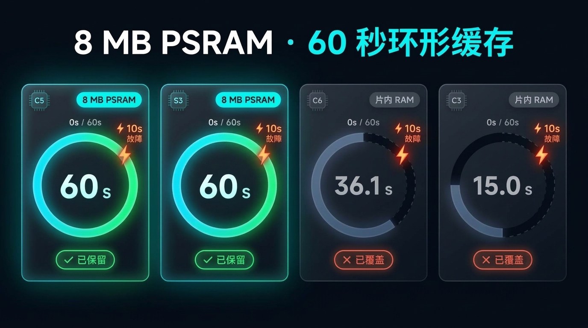
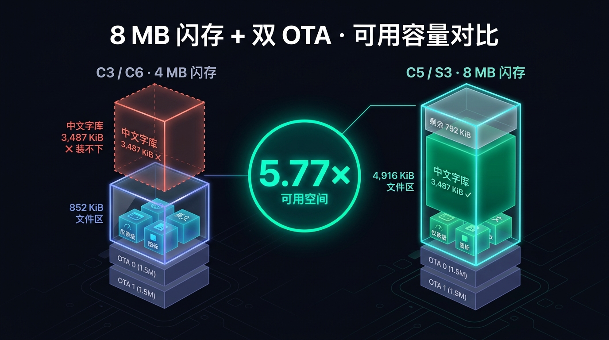
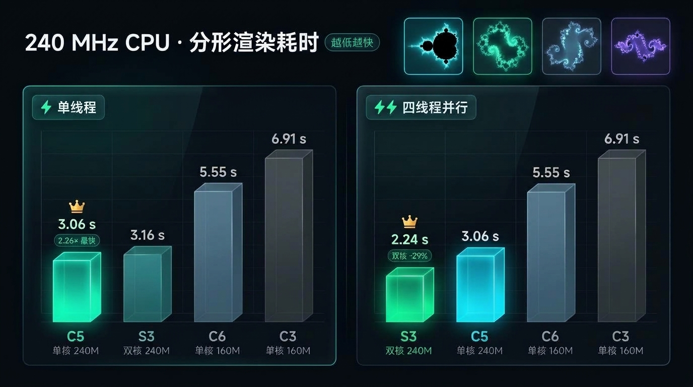
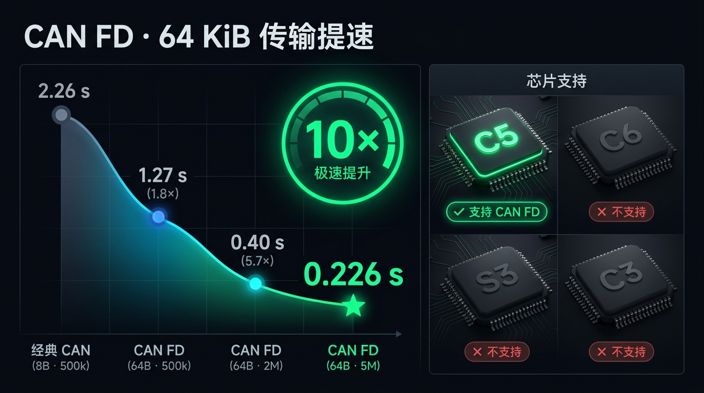
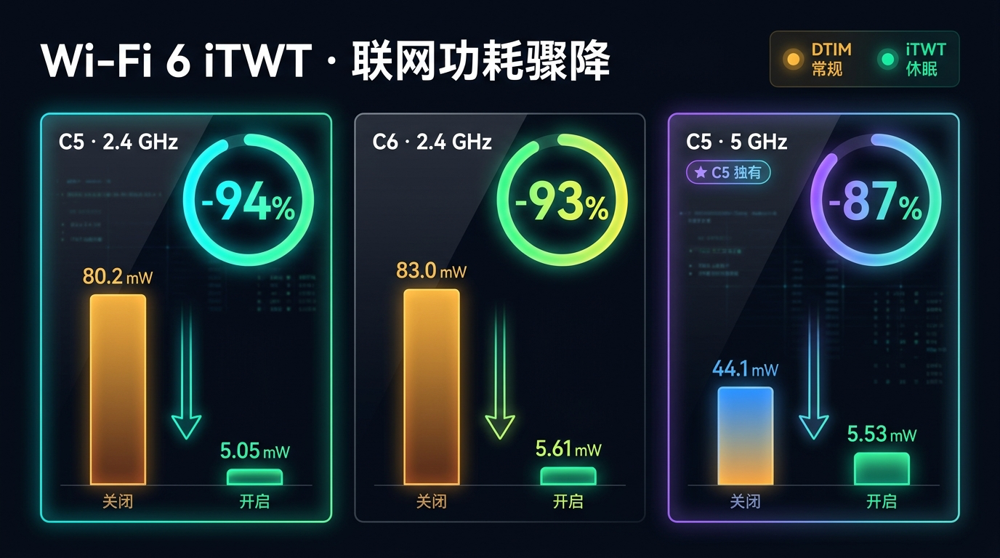

# 四款 XIAO 同台实测：6.9 美元 ESP32-C5 的性能对比与选购指南

[乐鑫 ESP32-C5](https://www.espressif.com/zh-hans/products/socs/esp32-c5) 刚发布那会儿，身边不少常做硬件的朋友都在念叨它。原因很实在：玩了这么多年 ESP32，大家终于等来了一颗能连 5 GHz Wi-Fi 的小芯片。不过等真板子陆续到手，我去网上搜了一圈评测，看完却觉得不太解渴。绝大多数文章还是在照着规格书念参数，很少有人真把这颗新芯片和我们抽屉里攒了一堆的 C3、C6、S3 摆到同一张桌子上，刷进同一份代码去跑几个实打实的日常活儿。手头的旧板子又不是不能用，多花一点钱换 C5，到底能解决哪些以前干瞪眼的麻烦，光看纸面数字其实很难有概念。

真要把几代芯片放在一起比出个高下，先把开发板统一下来最省心。市面上的开发板外围设计五花八门，光是板载稳压芯片的静态漏电就能差出不少，拿不同厂家的板子测功耗根本没法看。所以我干脆选了 Seeed Studio（矽递科技）的 XIAO 系列来做这次横评的主角，把 [XIAO ESP32-C3](https://www.seeedstudio.com/Seeed-XIAO-ESP32C3-p-5431.html)、[XIAO ESP32-C6](https://www.seeedstudio.com/Seeed-Studio-XIAO-ESP32C6-p-5884.html)、[XIAO ESP32-S3](https://www.seeedstudio.com/XIAO-ESP32S3-p-5627.html) 和新出的 [XIAO ESP32-C5](https://www.seeedstudio.com/Seeed-Studio-XIAO-ESP32C5-p-6609.html) 四兄弟全凑齐了。这四块板子都是大拇指盖大小（约 21 × 18 毫米），引脚顺序一致，都带外置天线座，背面也都留好了 3.7 V 锂电池充放电焊盘，外围供电和体积条件基本拉到了同一条起跑线上。平时自己做小玩意儿我也偏爱用 XIAO，一方面它足够小，智能戒指盒、胸牌或者机械臂关节这种局促的地方都塞得进去；另一方面插上面包板就能直接配现成的 Grove 传感器免焊打样，等原型调通了，靠着背面纯平的邮票孔又能直接贴片到自己的 PCB 上做成成品。

## 价格对比与五项实测内容

动手跑测试之前，先把四块板子现在的单块零售价和核心规格摆出来对一对账：

| 开发板型号 | 核心处理器与主频 | 内存与闪存 | 无线与特色总线 | 单块售价 |
| --- | --- | --- | --- | --- |
| [XIAO ESP32-C3](https://www.seeedstudio.com/Seeed-XIAO-ESP32C3-p-5431.html) | 单核 RISC-V · 160 MHz | 400 KB SRAM · 4 MB Flash | 2.4G Wi-Fi 4 + BLE 5.0 | $4.90 |
| [XIAO ESP32-C6](https://www.seeedstudio.com/Seeed-Studio-XIAO-ESP32C6-p-5884.html) | 单核 RISC-V · 160 MHz（含低功耗核） | 512 KB SRAM · 4 MB Flash | 2.4G Wi-Fi 6 + BLE + Zigbee/Thread | $5.20 |
| [XIAO ESP32-C5](https://www.seeedstudio.com/Seeed-Studio-XIAO-ESP32C5-p-6609.html) | 单核 RISC-V · 240 MHz（含低功耗核） | 384 KB SRAM + 8 MB PSRAM · 8 MB Flash | 2.4G/5G 双频 Wi-Fi 6 + BLE + Zigbee/Thread + CAN FD | $6.90 |
| [XIAO ESP32-S3](https://www.seeedstudio.com/XIAO-ESP32S3-p-5627.html) | 双核 Xtensa LX7 · 240 MHz | 512 KB SRAM + 8 MB PSRAM · 8 MB Flash | 2.4G Wi-Fi 4 + BLE 5.0 | $7.49 |

把价格摆在一起看，C5 比入门款的 C3 贵了 2 美元，比同样支持 Wi-Fi 6 和 Zigbee 的 C6 贵了 1.7 美元，比 S3 则便宜约 0.6 美元。对一块五美元上下的小板子来说，比 C3 和 C6 贵出三四成算得上明显涨价了。估计不少人第一眼看完规格表都会犯嘀咕：一个小单片机平时也就发点传感器读数、收几个开关指令，数据量连 2.4 GHz 都喂不饱，多掏这两美元难道只是为了买一个 5 GHz 频段？更何况仔细看参数还能发现乐鑫精准的产品区隔，C5 的片内高速内存只有 384 KB，反而比 C6 的 512 KB 小了一圈，处理器也依然是单核，比 S3 少了一个核心。如果这 6.9 美元只是换来一个“能连 5G 路由”的名头，显然不够有说服力。

不过顺着配置表往下细看，C5 身上其实还多了好几处实在的硬件升级：新增了 8 MB 外置内存（PSRAM）、闪存翻倍到 8 MB、单核主频拉高到 240 MHz、内置了两路别人没有的 CAN FD 高速总线控制器，再加上双频 Wi-Fi 6 的低功耗休眠机制。这些改动落到实际项目里到底能换来多少体验提升，又有哪些短板需要注意，正是下面这五项对比测试想要回答的问题。我们不跑空洞的理论分数，而是直接测五个日常做项目最常碰到的实际需求：第一项测连续采集数据时，8 MB 外置内存能不能存下一整分钟的高频记录，顺带看看缩水的片内内存会不会拖后腿；第二项测开启双备份无线升级之后，8 MB 闪存还能装下多少前端界面和中文字库；第三项测 240 MHz 单核的实际运算速度，看它在单任务和多任务下跟双核 S3 各差多少；第四项搭一条真实双绞线，实测原生 CAN FD 总线比传统 CAN 快多少；第五项拔掉数据线改用电池供电，实测 5 GHz 频段和 Wi-Fi 6 休眠到底能省多少电。五套工程全部基于 [ESP-IDF v6.1.1](https://docs.espressif.com/projects/esp-idf/en/stable/esp32c5/get-started/index.html) 编写，四块板子运行同一份 C 语言业务代码，测完自动核对数据校验和，用真实结果说话。

## 一、内存容量实测：靠 8 MB 外置内存完整录下一分钟高频数据

拿单片机做过无人机姿态记录、3D 打印机振动排查或者设备异常监测的朋友，多半遇到过历史数据被覆盖的麻烦。故障往往只发生在那一瞬间，等你发现不对劲跑过去断电导数据，时间早就又过去四五十秒了。如果不额外焊存储卡，单片机就只能在内存里开一块环形缓冲区（Ring Buffer）循环记录最新数据，内存一旦不够大，新涌进来的采样点就会把几十秒前的故障波形彻底冲掉。

为了保证四块板子面对的输入信号分毫不差，我在第一个工程 `01-psram-recorder` 的 `recorder.c` 里没有外接手敲传感器，而是让板子自己在内部实时合成一套完全一致的三轴振动波形：每秒生成两千组数据，每组占 6 个字节，完整录满 60 秒大概需要 0.7 MB（约 700 KB）内存。当时间精准走到第 10 秒时，程序会自动塞入一段持续 10 毫秒的剧烈脉冲充当突发故障。申请环形缓冲区时，`alloc_buffer()` 会优先检查芯片有没有外置 PSRAM；遇到没有外置内存的 C3 和 C6，或者人为加上 `mem=internal` 参数做对照测试时，程序就去查询片内内存的最大可用块，在给系统预留 32 KB 安全余量之后，能拿多少算多少：

```c
#define INTERNAL_CAPS        (MALLOC_CAP_INTERNAL | MALLOC_CAP_8BIT)
#define INTERNAL_RESERVE     (32 * 1024)
#define HEAP_BLOCK_OVERHEAD  64

static size_t alloc_buffer(size_t want, rec_mem_t mem)
{
    s_rec.psram = false;
    if (mem == REC_MEM_AUTO && heap_caps_get_total_size(MALLOC_CAP_SPIRAM) > 0) {
        s_rec.buf = heap_caps_malloc(want, MALLOC_CAP_SPIRAM | MALLOC_CAP_8BIT);
        if (s_rec.buf != NULL) {
            s_rec.psram = true;
            return want;
        }
    }
    size_t largest = heap_caps_get_largest_free_block(INTERNAL_CAPS);
    size_t free_total = heap_caps_get_free_size(INTERNAL_CAPS);
    size_t size = want;
    if (largest > HEAP_BLOCK_OVERHEAD && size > largest - HEAP_BLOCK_OVERHEAD)
        size = largest - HEAP_BLOCK_OVERHEAD;
    if (free_total > INTERNAL_RESERVE && size > free_total - INTERNAL_RESERVE)
        size = free_total - INTERNAL_RESERVE;
    size -= size % REC_SAMPLE_BYTES;
    s_rec.buf = size ? heap_caps_malloc(size, INTERNAL_CAPS) : NULL;
    return s_rec.buf ? size : 0;
}
```

整整一分钟的采集完全靠芯片微秒级硬件定时器卡点推进，循环写入内存，期间电脑不帮板子暂存任何数据。等 60 秒结束停机，电脑端脚本发送导出指令，板子把缓冲区里留存的样本打包算好 CRC32 校验值传回电脑，由 Python 脚本核对数据无误后检查第 10 秒的那段故障波形还在不在。



导回来的结果既展示了外置大内存的优势，也如实反映出 C5 片内内存偏小的现状。只有片内内存的 C3 扣掉系统开销后只挤出了约 180 KB 空间，只能留住最后 15 秒；片内内存更大的 C6 拿到了 420 多 KB，撑住了最后 36 秒，可惜离第 10 秒的故障点还是差了十来秒，异常记录照样被覆盖了。而配有 8 MB 外置内存的 C5 和 S3 轻松拿下了所需的全部 0.7 MB 空间，0 到 60 秒完整保留，稳稳抓住了第 10 秒的异常脉冲。而且因为大缓冲区放在了外置内存里，录制结束时 C5 的片内内存还宽裕地剩着三百多 KB（S3 片内底子更大，剩了约 370 KB），把整段数据经串口导回电脑 C5 只花了不到 5 秒，比 S3 的 13 秒出头快了不少。不过当我强行禁用外置 PSRAM 再跑一遍对照实验时，C5 片内 384 KB 内存偏小的短板就立刻显露出来了：单靠片内内存它只能留住约 22.5 秒的数据，比 S3 片内的约 24 秒略少一点，跟 C6 的 36 秒更是拉开了明显差距。

把正反两面的结果放在一起看，这 8 MB 外置内存对日常项目的提升其实非常实在。它让 6.9 美元的双频小板直接跨进了“兆字节级缓存”的门槛：比如做这两年很热门的 AI 语音对话小摆件，普通清晰度的语音每秒大约占 32 KB，以前用 C3 或 C6 录不到十秒内存就见底了，边录边传一旦网络波动声音就会断断续续，现在有了 8 MB 外置内存，一口气在本地录上两三分钟语音、或者整段缓存云端发回来的音频回复都绰绰有余；再比如驱动一块两三百像素见方的彩色小屏幕，一帧画面就要占掉一百多 KB，在外置内存里开双缓冲或者提前解好十几帧动图，画面切换就彻底告别了闪烁撕裂；平时拉取天气预报、日程表这类几十上百 KB 的长网页 JSON 数据，也不用再小心翼翼地分段解析防崩溃了。同时它的不足也很明确：C5 的片内高速内存比 C6 小了一圈，一旦同时开启双频 Wi-Fi 和蓝牙协议栈，片内剩余内存会比较紧俏，而且外置内存读写速度不如片内快，工作时还会增加一点功耗。因此平时给 C5 写程序时，最好在工程配置里打开允许大块内存自动分配到外置 PSRAM 的选项，把音频、屏幕画布和长文本缓存主动挪到外置内存去，把宝贵的片内高速内存留给无线底层驱动和硬件中断使用。

## 二、闪存空间实测：保留双备份无线升级后还能装下整套中文字库

做 DIY 硬件一旦装进 3D 打印外壳、拧上螺丝甚至封好热熔胶，最怕的就是为了改几行代码再去拆壳返工。成熟的做法是开启双分区无线升级（Dual OTA），在闪存里对称划出两个固件槽，一个运行当前程序，另一个在后台接收新固件，哪怕升级中途断电重启也能自动退回旧版不变砖。但这套安全机制很占地方，两个固件槽直接就要分走 3 MB 闪存。扣掉这部分固定开销后，剩下的地方还够不够放一套本地网页控制后台和中文字库，就是第二个工程 `02-flash-ota` 测试的重点。

翻开工程里的 `partitions-4mb.csv` 和 `partitions-8mb.csv` 两张分区表，四块板子前 3 MB 多的布局完全相同，两个升级槽各占 1.5 MB。真正的区别全在后面的文件存储区（`storage`）上，4 MB 闪存的 C3 和 C6 只剩不到 0.9 MB 的原始空间，而 8 MB 闪存的 C5 和 S3 直接扩大到了将近 5 MB：

```text
# partitions-4mb.csv（C3、C6）：预留双 OTA 后文件区原始大小约 0.9 MB
ota_0,    app,  ota_0,   0x20000,  0x180000
ota_1,    app,  ota_1,   0x1a0000, 0x180000
storage,  data, fat,     0x320000, 0xe0000

# partitions-8mb.csv（C5、S3）：预留双 OTA 后文件区原始大小近 5 MB
ota_0,    app,  ota_0,   0x20000,  0x180000
ota_1,    app,  ota_1,   0x1a0000, 0x180000
storage,  data, fat,     0x320000, 0x4e0000
```

板端代码 `web.c` 搭了一个完整的本地网页文件服务和无线升级接口，电脑端脚本则依次往板子里上传五套真实的前端资源包：先是几十 KB 的图表仪表盘、约 200 KB 的图标库和几十 KB 的英文字体，第四包是约 3.4 MB 的思源黑体常规中文字库，第五包是另一套约 3.5 MB 的粗体中文字库。为了不在写满时留下损坏的半截文件，板端每次检测到空间不足都会立刻调 `unlink(path)` 删掉未写完的文件并返回 `507` 状态码，电脑脚本收到信号后把当前包撤回清理干净，接着直接通过局域网推送 V2 新版固件完成无线升级，重启后再把板子上存着的所有文件逐一读回电脑核对哈希指纹：

```c
if (!full && fwrite(s_io, 1, n, f) != (size_t)n) {
    full = true;
}
if (fclose(f) != 0 || full) {
    unlink(path);
    return send_error(req, "507 Insufficient Storage", "no_space");
}
```



实测下来，4 MB 和 8 MB 的可用空间差出了将近六倍，同时测试日志也暴露了 C5 在固件体积和擦写速度上的两处不足。先看存储表现：C3 和 C6 格式化完文件系统后，实际能用的空间一共只有 800 多 KB；装完英文仪表盘、图标和英文字体就用掉了一半，剩下四百多 KB 刚碰到 3.4 MB 的中文字库就立刻提示空间不足退了回来。而同样留足两个升级槽的 C5 和 S3，格式化后拥有约 4.8 MB 的可用空间，不仅轻松装齐了前三套界面包，还把整套 3.4 MB 的常规中文字库完整存了进去，装完手里还富余近 0.8 MB 空间（直到尝试塞入第二套 3.5 MB 粗体中文字库时才触顶），随后完成无线升级重启，一百多个前端和字库文件全部完好无损。不过横向比对细节时，C5 有两项指标不如其他几块板：同样一份源码编译出来，S3 和 C3 的固件都在 0.9 MB 上下，而 C5 因为要包含 2.4G 和 5G 双频驱动库，固件体积超过了 1 MB，是四块板里最占地方的；无线 OTA 升级耗时上，C5 花了约 23 秒，也比 S3 的 15 秒多以及 C3、C6 的不到 20 秒慢了一些。

这一关的结果对做完整小产品的玩家很有参考价值。虽然闪存从 4 MB 升到 8 MB 账面上只翻了一倍，但扣掉 3 MB 无线升级的刚性占用后，真正归用户自由支配的存储区其实从不到 0.9 MB 扩大到了将近 5 MB。以前拿 4 MB 板子做桌面天气时钟、鱼缸控制器或者家用小仪表，想开无线升级就塞不下完整字库，只能手动挑几百个常用汉字取模，一旦网页或屏幕上显示生僻一点的人名、歌名就会变成空白方框；换成 C5 之后，不拆壳无线升级和整套常用中文字库终于可以兼顾了，富余出来的近 0.8 MB 还能再放几段提示音效，或者在家里断网时本地缓存好几周的传感器历史曲线。至于它固件偏大、升级稍慢的两个小缺点，只要在建工程划分分区表时提前留个心眼——如果后续还要叠加上蓝牙和 Matter 等大体积协议栈，不妨把默认 1.5 MB 的固件槽扩到 1.8 MB 或 2 MB，同时对多字重字体做一下常用字裁剪，就能稳稳避开空间瓶颈。

## 三、处理器算力实测：单线程运算更快，多线程负载仍需双核 S3

从规格上看，C3 和 C6 是 160 MHz 单核，C5 提升到了 240 MHz 单核，贵了约 0.6 美元的 S3 则是 240 MHz 双核。单核提频之后日常用起来到底快了多少，少了一个核心又会在什么情况下吃亏，靠第三个工程 `03-cpu-render` 跑一组纯计算任务就能看得很明白。

为了排除外部因素干扰，只测处理器核心本身的整数运算效率，`render.c` 在设计上特意锁定了三个条件：全程不用浮点数，改用手写的 `Q7.24` 格式 32 位定点数做乘加运算，避免不同芯片有无硬件浮点单元造成偏差；每次只在片内栈上申请一行 320 字节的小数组，算完立刻汇总校验值，不让外置内存掺和进来；计时期间彻底关掉无线和串口打印。四块板子统一计算相同的四张 320×240 分形图像，合计执行两千六百多万次循环迭代：

```c
#define FRAC    24                  /* Q7.24 定点数格式 */
#define ESCAPE  (4 << FRAC)

static inline uint32_t iterate(int32_t x, int32_t y, int32_t cx, int32_t cy)
{
    for (uint32_t i = 0; i < RENDER_MAX_ITER; i++) {
        int32_t x2 = (int32_t)(((int64_t)x * x) >> FRAC);
        int32_t y2 = (int32_t)(((int64_t)y * y) >> FRAC);
        if (x2 + y2 > ESCAPE) {
            return i;
        }
        y = (int32_t)(((int64_t)x * y) >> (FRAC - 1)) + cy;
        x = x2 - y2 + cx;
    }
    return RENDER_MAX_ITER;
}
```

测试分成了两种调度模式：单线程 `seq` 模式只开一个任务按顺序算完四张图，考察单核执行效率；四线程 `par` 模式同时拉起四个任务一起算，单核芯片只能靠时间片轮流切换，而双核 S3 可以把任务分摊到两个物理核心上并行处理。每种模式连跑 5 轮取中位数，最后导回全部三十万个像素点比对校验值，四块板算出的画面完全一致。



实测耗时把单核与双核的优劣划分得非常清楚。在单线程模式下，C3 花了近 6.9 秒，同样是 160 MHz 但换用新架构的 C6 缩短到了约 5.5 秒（快了四分之一），双核 S3 只用一个核时花了约 3.2 秒，而单核 C5 用了约 3.1 秒拿下第一，速度是 C3 的两倍多，比 C6 也快了八成左右。这里有个很值得留意的细节：C5 的主频只比 C3 高了一半（240 MHz 对比 160 MHz），实际运算速度却快了一倍不止，多出来的提升完全来自乐鑫新一代 RISC-V 核心更高的指令执行效率，甚至让它在单任务硬算时比同频的 S3 还略快一点。但切到四线程并行模式后，单核的局限就显现出来了：C5、C6 和 C3 的耗时跟单线程完全一样，没有任何缩短；而双核 S3 靠着两个核心同时干活，把总时间压到了约 2.2 秒，反过来比单核 C5 快了将近三成。

这组一赢一输的数据，把 C5 和 S3 的适用边界讲得明明白白。对大多数普通玩家和创客来说，平时写的 Arduino 控制逻辑、传感器滤波、JSON 数据解析、小屏幕 LVGL 界面刷新或者云平台 TLS 加密连接，绝大多数都是单线程顺序执行的任务。以前在 C3 上连一次加密服务器或者刷一页复杂界面能明显感到停顿，现在 C5 的单核运算能力已经站到了主流高性能微控制器的第一梯队，日常响应速度跟 S3 一样干脆利落。不过 C5 毕竟砍掉了第二个核心，同时还省掉了 S3 身上专门用于机器学习的向量加速指令（SIMD）以及并口摄像头（DVP）接口。所以如果手头的项目需要接摄像头实时采图（比如官方的 S3 Sense 视觉板场景）、在本地跑离线语音唤醒词识别，或者必须一边满负荷维持高频无线图传一边在后台做复杂解算，多花 0.6 美元上双核 S3 依然是更稳妥的选择；而在 C5 上开发联网带屏项目时，只要注意别在代码里写死循环长时间霸占单核，留出空闲让系统调度无线收发，日常体验完全够用。

## 四、CAN FD 总线实测：无需外挂协议芯片，数据传输提速十倍

前面三项测试里，C5 在存储和单核性能上追平了 S3、在多核并行上不如 S3，而第四项测试则是 C5 独有的强项。这两年做桌面机械臂关节驱动、电动滑板车改装或者汽车 OBD 数据读取的玩家越来越多，这类电机和车载环境干扰大、线束长，普遍采用双绞线 CAN 总线。但传统经典 CAN 每帧最多只能装 8 个字节，平时发个简单指令够用，一旦要高频同步十几个电机的状态参数，或者顺着总线给关节电机刷固件，成千上万帧的帧头和等待间隙就会把速度拖得很慢。新一代 CAN FD 把每帧数据容量扩大到了 64 字节，还支持在抢到总线后把数据段单独切到几兆的高波特率。查看底层硬件支持列表就能看到，四款芯片里只有 ESP32-C5 原生支持 CAN FD，而且片内直接给了两个独立控制器（C6 虽有两个控制器但只支持经典 CAN，C3 和 S3 则只有一个经典 CAN 控制器）。

利用片内自带的两个控制器，我在 `04-canfd` 工程的 `bus_test.c` 里直接用一块 XIAO ESP32-C5 搭建了完整的双节点物理总线：把发送端和接收端分别接上两块 [Adafruit CAN Pal（TJA1051T/3）收发器模块](https://www.adafruit.com/product/5708)，中间连上双绞线并打开两端的 120 欧姆终端电阻。为了把每帧空间全部留给有效数据，代码把包序号编码进了 29 位扩展帧 ID 里，让 8 字节或 64 字节的数据区全部装满待测内容，连续传输一整块 64 KB 的随机数据，并通过 `.fdf`（扩充帧长）和 `.brs`（提高数据段速率）两个开关分三步对比实际耗时：

```c
twai_frame_t *f = &s_slots[sent % TX_SLOTS];
*f = (twai_frame_t){
    .header = {
        .id  = ID_BASE + sent,          /* 29 位扩展 ID 携带序号，不占数据字节 */
        .ide = 1,
        .fdf = fd,                      /* 0 = 8B 经典帧, 1 = 64B CAN FD 帧 */
        .brs = (cfg->mode == BUS_FD),   /* 1 = 仲裁后数据段切至 2M / 5M 高速 */
    },
    .buffer = tx_buf + sent * payload,
    .buffer_len = payload,
};
twai_node_transmit(node_a, f, SLOT_WAIT_MS);
```

接收端在硬件中断里实时收包、核对包序号并原位拼回 64 KB 数据块，收齐最后一帧立即停表，再对收发两端的数据做完整 CRC32 校验并检查硬件错误计数。



在仲裁速率统一设为 500 kbps 的条件下，三档实测清晰展示了提速是怎么来的。用传统经典 CAN（每帧 8 字节）传完 64 KB 数据要切成八千多帧，耗时近 2.3 秒，实际有效吞吐只有 230 kbps 出头。切到不加速的 CAN FD 模式（每帧扩到 64 字节，速率仍为 500 kbps）后，哪怕波特率没变，光靠总帧数减少到一千帧左右、省下七千多次帧头开销，时间就缩短到了约 1.3 秒，快了近八成。再打开数据段高速切换后，2 Mbps 档位耗时直接降到 0.4 秒（提速超过 5.6 倍）；拉满收发器支持的 5 Mbps 上限后，传完 64 KB 仅仅用了 0.2 秒出头，有效吞吐超过 2.3 Mbps，正好是经典 CAN 的整整 10 倍，且全程零丢包、零错误。

这项原生能力放在机器人和车载改装场景里能省掉不少硬件麻烦。以前想用 C3 或 S3 控制支持 CAN FD 的新一代机器人关节电机，或者读取新款汽车的高速传感器总线，必须在板子外面额外加一颗像 MCP2518FD 这样的独立协议转换芯片，光外挂芯片和晶振就要多花两三美元，还得占掉四五个 SPI 引脚、把电路板面积撑大一圈。现在 6.9 美元的 C5 直接在芯片内部集成了两路控制器，不仅能直接跑高帧率的多轴电机控制闭环、把固件升级时间缩短九成，甚至单靠一块板子就能一边接 500 kbps 的老式车载设备、一边转出高速 CAN FD，顺手再用 5 GHz Wi-Fi 把总线数据无线传回电脑做调试分析仪。当然实际接线画板时也有三点客观限制需要留意：第一，C5 内置的是数字控制器而非物理收发器，外部仍然必须接一颗支持高速率的 3.3 V 收发器小芯片，不能直接把引脚连上双绞线；第二，XIAO 板子本身只引出了 11 个常规引脚，两路总线全开就要用掉 4 个，外设较多时得提前规划好引脚；第三，5 Mbps 在桌面短线测试虽然跑出了 10 倍速，但放到几米长的机身内部线束上对阻抗匹配和终端电阻非常敏感，实际工程走线较长时设在 2 Mbps（仍有 5.6 倍以上提速）往往更稳妥。

## 五、双频 Wi-Fi 6 功耗实测：5 GHz 抗干扰与毫瓦级低功耗待机

最后一项测试聚焦在无线小设备最让人头疼的家庭联网稳定性和电池续航上。平时做个贴在墙上的墨水屏日历、阳台花盆湿度计或者信箱提醒器，用蓝牙或 Zigbee 虽然省电，但家里必须另配网关；直连家里路由器 Wi-Fi 最省事，可传统 Wi-Fi 每隔一两百毫秒就要醒来听一次路由器的广播信标，二十多毫安的平均电流让小锂电池撑不过两三天。C5 同时提供了 Wi-Fi 6 的目标唤醒时间（iTWT）休眠机制和 XIAO 系列首次支持的 5 GHz 频段，为了测出真实联网状态下的耗电量和潜在代价，`05-wifi6-itwt` 工程采用拔掉 USB 线的纯电池供电方式做了实测。

测毫安级的休眠电流不能插着电脑 USB 线，否则串口电路底噪会干扰读数。代码里统一给四块板子开启了空闲降频和自动浅睡（`light_sleep_enable = true`），让芯片在两次通信间隙自动关断射频打盹。针对支持 Wi-Fi 6 的 C5 和 C6，程序调用 `esp_wifi_sta_itwt_setup()` 跟路由器协商定时唤醒周期。这里我特意测了一个容易被忽视的参数细节：ESP-IDF 官方示例默认的单次唤醒窗口长达约 65 毫秒，我在测试计划里额外增加了一组窄窗口配置（`twt2000w8`），把每次醒来停留的时间压缩到约 8 毫秒，对比缩短驻留窗口前后的耗电变化：

```c
esp_pm_config_t pm = {
    .max_freq_mhz = CONFIG_ESP_DEFAULT_CPU_FREQ_MHZ,
    .min_freq_mhz = esp_clk_xtal_freq() / 1000000,
    .light_sleep_enable = true,
};
ESP_ERROR_CHECK(esp_pm_configure(&pm));

wifi_itwt_setup_config_t sc = {
    .setup_cmd = TWT_REQUEST,
    .trigger = 1,
    .flow_type = 0,                 /* Announced 模式：醒来发触发帧取缓冲数据 */
    .wake_invl_expn = TWT_INVL_EXPN,
    .wake_duration_unit = 0,        /* 256 us 步进：默认约 65ms，窄窗口压至约 8ms */
    .min_wake_dura = p->wake_units,
    .wake_invl_mant = (uint16_t)(p->twt_ms * 1000 >> TWT_INVL_EXPN),
    .timeout_time_ms = 5000,
};
esp_wifi_sta_itwt_setup(&sc);
```

测试开始前先用 USB 把配网信息和测试流程写进板子闪存，拔掉数据线后立即由接在背面电池焊盘上的 [Nordic Power Profiler Kit II（PPK2）功耗分析仪](https://www.nordicsemi.com/Products/Development-hardware/Power-Profiler-Kit-2) 输出 3.7 V 模拟锂电池供电（S3 因启动瞬间电流峰值较大设为 4.2 V），以每秒十万次的采样率连续记录电流。测试期间板子保持联网，每 10 秒主动发一包 UDP 数据，同时响应电脑每隔 3 到 7 秒随机发来的 Ping 探测，同步统计平均功耗与响应延迟。



跑出来的实测数据既验证了可观的省电幅度，也抓到了官方默认参数的一个大坑，同时能看到 C5 与 C6 在休眠底电流上的细微差距。在关闭 TWT 的传统 2.4 GHz 常规省电模式下，S3 平均电流接近 40 mA，C3 约 25 mA，C6 和 C5 都在 22 mA 左右（折合功率约 80 mW，Ping 响应不到 80 毫秒）。第一个意外出现在半秒唤醒一次、搭配官方默认 65 毫秒宽窗口的 `twt500` 档位：C5 在 2.4 GHz 下电流不降反升，在 5 GHz 下更是蹿到了近 29 mA，比不开 TWT 反而多耗了一倍多的电。查看电流波形就能明白原因，半秒醒一次本来就很频繁，每次醒来还要硬撑着睁眼等满 65 毫秒才肯睡，空等耗掉的电比普通模式听信标还要多。直到把唤醒间隔拉长到 2 秒（`twt2000`），C5 在 2.4 GHz 下电流才降到了 6 mA 左右（省电超过七成，响应延迟约半秒且零丢包）；客观对比的话，没有外挂 PSRAM 负担的 C6 在同一档位做到了略低一点的 5.9 mA，两次唤醒之间的浅睡底电流也比 C5（约 0.2 mA）更接近零。当进一步换用 8 毫秒窄窗口（`twt2000w8`）后，C5 在 2.4 GHz 下的平均电流直接降到了约 1.4 mA（功率仅 5 mW 出头，砍掉了九成以上功耗；C6 同档约 1.5 mA），代价则是外部随机指令的平均等待时间拉长到了三四秒，十几次探测里还因为窗口太窄漏掉了三包。而 C5 独有的 5 GHz 频段则表现得很亮眼：哪怕完全不开 TWT，干净高速的 5 GHz 信道让每次收发迅速收工，常规待机电流直接从二十多毫安降到了约 12 mA（约 44 mW），响应延迟也缩到了最快的 68 毫秒；开启窄窗口休眠后同样低至约 1.5 mA（约 5.5 mW，省电近九成），而且实测十几次随机探测一次没丢。

把这组测试结果放到日常家居场景里，5 GHz 和低功耗休眠的实用价值就很清楚了。现在普通家庭的 2.4 GHz 频段早就挤满了蓝牙外设、智能家电、微波炉干扰和邻居家的路由器，而且许多新款路由器默认把 2.4G 和 5G 合并成一个网络名称，只支持 2.4 GHz 的老开发板经常配不上网或莫名掉线；C5 切进干净的 5 GHz 频段后不仅连接稳、响应快，连插电运行时的常规功耗和发热都跟着降了近一半。再算一笔直观的电池账：拿创客常用的 1000 mAh 小容量软包锂电池来说，以前跑二三十毫安的传统 Wi-Fi，充满电最多撑一两天就彻底没电了，逼着你给小作品拖一根电源线；现在把 C5 调到 1.4 mA 左右的窄窗口休眠，保持全天不断网在线、每 10 秒上报一次，同一块小电池就能连续工作将近一个月，如果把上报周期放宽，几个月充一次电完全可行。同时实测也给我们总结出了三条很实用的避坑经验：一是 5 GHz 穿墙衰减比 2.4 GHz 大，放在同一间屋子或隔一扇门效果极好，要是隔了两堵承重墙装在阳台角落还是得切回 2.4 GHz，且 iTWT 省电需要家里的 Wi-Fi 6 路由器支持；二是千万别拿默认的 65 毫秒宽窗口去配一秒以内的短周期，否则反而更费电；三是根据设备用途分档设置，插电或需要秒回指令的开关直接用 5 GHz 常规模式，电池供电但需要手机随时点按刷新的墨水屏用 2 秒默认窗口（约 6 mA、半秒响应不丢包），纯定时上报的温湿度计再用 2 秒配 8 毫秒窄窗口去追求最长续航。

## 优缺点汇总与四款开发板选购建议

五项实测全部跑完，再回看开头那张价格表，就能清楚看到这四款开发板各自的定位取舍。6.9 美元的 [XIAO ESP32-C5](https://www.seeedstudio.com/Seeed-Studio-XIAO-ESP32C5-p-6609.html) 并不是一块毫无短板的“全能神板”，它的取舍非常明确：片内高速内存只有 384 KB，纯片内可用空间和浅睡底电流不如轻装上阵的 C6；双频固件体积超过 1 MB，无线升级擦写比 S3 慢几秒；处理器依然是单核，没有摄像头接口和 AI 向量加速指令，遇到多线程重算力任务还是跑不过双核 S3；5 GHz 频段的穿墙覆盖不如 2.4 GHz，跑高速 CAN FD 也需要搭配外部收发器芯片。

但反过来讲，它恰好把普通玩家和 Maker 日常做项目最常卡壳的几块短板一次性补齐了。过去选 5.2 美元的 C6，虽然有 Wi-Fi 6 和 Zigbee，可一旦想放整套中文字库、做长数据缓存就会被 4 MB 闪存和无外置内存卡住；过去选 7.49 美元的 S3，虽然有了 8 MB 大内存、8 MB 大闪存和 240 MHz 快响应，却只能连拥挤费电的 2.4 GHz 老 Wi-Fi，也玩不了 Zigbee/Thread 和高速 CAN FD。C5 把 S3 级别的大存储与单核速度、C6 级别的低功耗新无线协议，以及独有的 5 GHz 双频和双路 10 倍速 CAN FD 整合进了同一块拇指大小的板子里。

因此在具体选购时，直接按手头的项目需求对号入座最省钱省心。如果要批量做十几个功能单一的极简小节点，比如基础的蓝牙信标、纯 Zigbee 门磁或普通无线开关，既不用存中文字库也不用大内存缓存，买 $4.90 的 [XIAO ESP32-C3](https://www.seeedstudio.com/Seeed-XIAO-ESP32C3-p-5431.html) 或休眠底电流极低的 $5.20 [XIAO ESP32-C6](https://www.seeedstudio.com/Seeed-Studio-XIAO-ESP32C6-p-5884.html) 性价比最高；如果项目明确要接摄像头做图像采集、跑本地离线语音唤醒词识别或者双核并行计算，多花约 0.6 美元买 $7.49 的 [XIAO ESP32-S3](https://www.seeedstudio.com/XIAO-ESP32S3-p-5627.html) 依然不可替代。而除了这两类特定场景之外的绝大多数日常创作，无论是想稳稳连上家里双频合一的 5 GHz 路由、想靠一块小锂电池长期挂网工作、想在保留无线升级的同时装进完整中文字库与网页后台，还是想做高速 CAN FD 机器人总线，多花不到两美元入手 $6.90 的 [XIAO ESP32-C5](https://www.seeedstudio.com/Seeed-Studio-XIAO-ESP32C5-p-6609.html)，带来的实用提升完全值回票价。

## 后续连载预告：基于 XIAO ESP32-C5 的四个实战项目

摸清硬件性能底子之后，接下来就到了真刀真枪做东西的环节。围绕开源社区里关注度很高、也最能发挥 C5 双频优势的几个应用方向，我手头已经准备好了四个具体的实战项目，后续会写成系列教程把完整源码、配置步骤和实测过程逐一分享出来。

第一个项目是用 5 GHz Wi-Fi 把环境传感器稳定接入 [Home Assistant](https://www.home-assistant.io/integrations/esphome/)。很多朋友家里的 2.4 GHz 频段同时跑着 Zigbee 灯具、蓝牙设备和十几块老款 ESP 小板，信号互相干扰导致传感器经常掉线，遇到双频合一的路由器配网也很折腾。我打算利用新版 [ESPHome](https://esphome.io/components/wifi/) 的 `band_mode: 5GHZ` 频段锁定功能，把 [BH1750 光照传感器](https://esphome.io/components/sensor/bh1750/)等常用模块直接固定连到家里的 5 GHz 频段上，并在文章里详细演示路由器信道核验和断网自动恢复的完整配置方法。

第二个项目是不经过路由器的双板 5 GHz [ESP-NOW](https://docs.espressif.com/projects/esp-idf/en/stable/esp32c5/api-reference/network/esp_now.html) 点对点低延迟通信。大家做无线遥控器、灯光同步触发或者高频传感器回传时很喜欢用免配网的 ESP-NOW 协议，但以前它只能挤在嘈杂的 2.4 GHz 频段里，周边网络一多就容易出现延迟抖动。换用两块 XIAO ESP32-C5 直接在干净的 5 GHz 信道上收发数据，单次往返响应可以压到 1 毫秒以内，连续传数据的有效吞吐也能明显提升，后续我会把这套双板对测固件和不同距离下的实测表现单独写一篇发出来。

第三个项目是搭建“2.4G 收蓝牙、5G 回传数据”的 [ESPHome 蓝牙代理（Bluetooth Proxy）](https://esphome.io/components/bluetooth_proxy/)。平时用老款单频 ESP32 给家里的米家或 BTHome 蓝牙温湿度计做信号中继时，蓝牙扫描和 Wi-Fi 上传全都挤在 2.4 GHz 共用一根天线抢时间片，设备多了很容易漏收广播。改用 C5 来做刚好可以实现频段分流，让蓝牙留在 2.4 GHz 专心收广播和维持连接，再通过 5 GHz Wi-Fi 把数据回传给 Home Assistant，连隐藏网络名称和 5 GHz 雷达避让（DFS）信道这类容易踩坑的配网细节我也会一并整理好分享给大家。

第四个项目是给 XIAO ESP32-C5 适配开源社区非常热门的 [ESP32 Marauder](https://github.com/justcallmekoko/ESP32Marauder) 无线测试固件，并配上一套打开电脑浏览器就能直接操作的中英文控制台界面。不需要额外焊接屏幕和按键，用一根数据线连上笔记本在房间里走一圈，就能在网页上绘出室内 2.4 GHz、5 GHz 与蓝牙信号的强弱分布图、同屏对比各个房间的双频信号表现、导出抓包文件，还可以体验一把利用 Wi-Fi 信道状态信息（CSI）在不装摄像头和红外传感器的情况下检测室内人员走动。如果你对这四个实战项目里的哪一个最感兴趣，欢迎先点个关注留言告诉我，我们下篇实战文章见。
